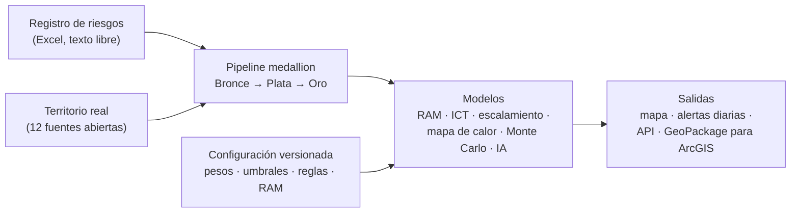
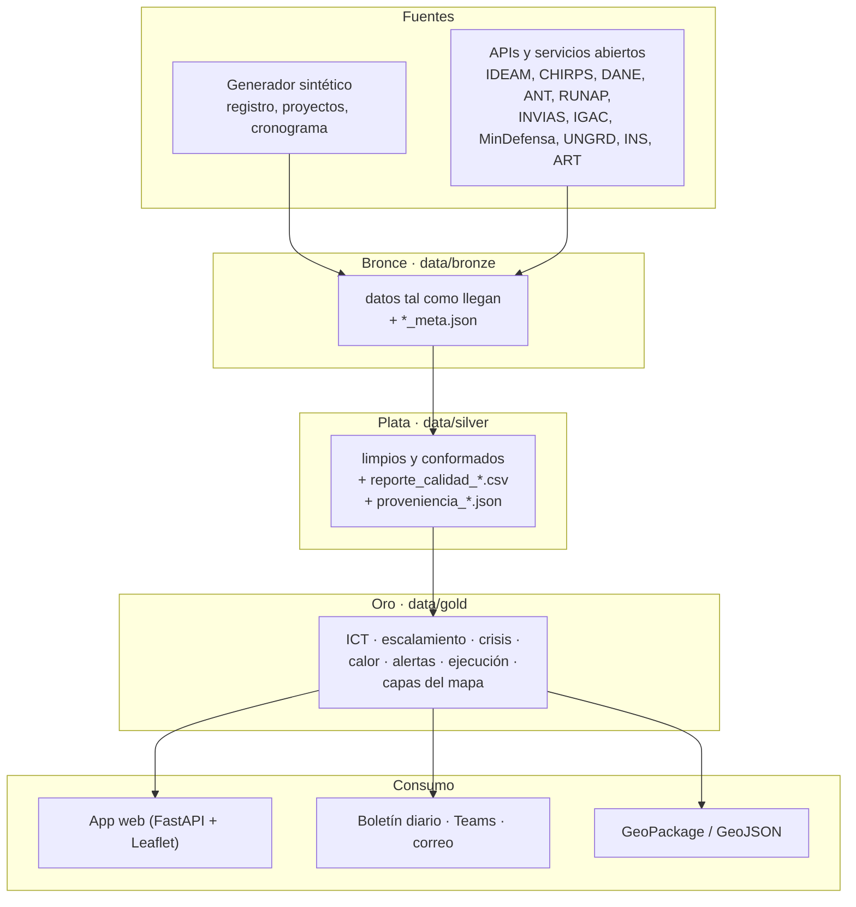
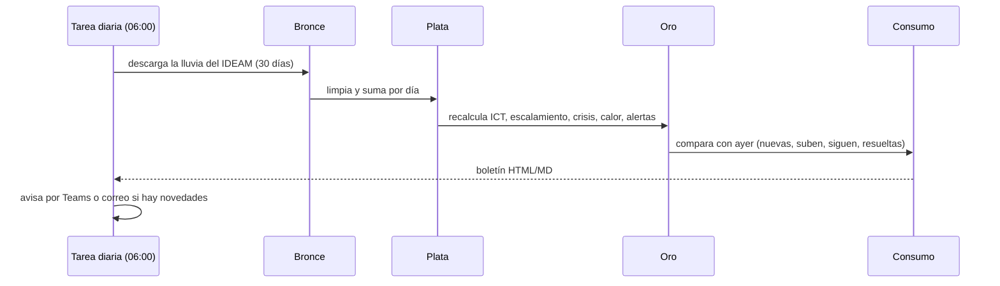

# Mapa de riesgos multicriterio para los proyectos de La Guajira

**Convocatoria Transforma la Energía · Reto 5 (Grupo Ecopetrol) · Propuesta y piloto de CEN&T Ingenieros Consultores**

Documento de descripción completa del proyecto: el problema, la solución, cómo se abordó y cómo funciona el piloto paso a
paso, desde la extracción de los datos hasta los modelos, la aplicación y el porqué de cada decisión.

> **Sobre los datos del piloto.** El registro de riesgos, los proyectos, los paquetes de trabajo y su cronograma son
> **sintéticos**: no son información de Ecopetrol ni de ninguna comunidad. El **territorio es real**: clima, vías, ríos,
> municipios, censo, resguardos, áreas protegidas, delitos y emergencias vienen de datos abiertos oficiales. El modelo cruza
> los dos. Por eso el piloto demuestra el mecanismo completo; sus cifras no son el riesgo real de ningún proyecto.

---

## Contenido

1. [Resumen](#1-resumen)
2. [El problema](#2-el-problema)
3. [La solución](#3-la-solución)
4. [Cómo lo abordamos](#4-cómo-lo-abordamos)
5. [Arquitectura general](#5-arquitectura-general)
6. [Fuentes de datos](#6-fuentes-de-datos)
7. [El pipeline, paso a paso](#7-el-pipeline-paso-a-paso)
8. [Los modelos](#8-los-modelos)
9. [La aplicación](#9-la-aplicación)
10. [Tecnologías](#10-tecnologías)
11. [Calidad, pruebas y trazabilidad](#11-calidad-pruebas-y-trazabilidad)
12. [Por qué funciona](#12-por-qué-funciona)
13. [Cumplimiento del reto](#13-cumplimiento-del-reto)
14. [Limitaciones y camino a producción](#14-limitaciones-y-camino-a-producción)
15. [Cómo ejecutarlo](#15-cómo-ejecutarlo)
16. [Glosario](#16-glosario)

---

## 1. Resumen

Construimos un **modelo matemático, estadístico y tecnológico** que integra geográficamente el registro de riesgos de los
proyectos con las variables reales del territorio de La Guajira, y lo convierte en información para decidir:

- **Un índice de criticidad por paquete de trabajo y por zona** (Índice de Criticidad Territorial, ICT, de 0 a 100), explicable
  criterio por criterio.
- **Mapas de calor territoriales** calculados con el mismo análisis multicriterio, más la densidad de amenazas y de
  oportunidades y los conglomerados estadísticamente significativos (Getis-Ord Gi\*).
- **Los puntos donde un riesgo podría escalar a crisis** y la zona de intervención prioritaria alrededor de cada uno.
- **Alertas tempranas diarias** automáticas, con boletín y envío por Teams o correo.
- **El impacto en el negocio**: días de atraso y dólares de sobrecosto por paquete y proyecto (simulación Monte Carlo).
- **Inteligencia artificial** que lee el texto libre del registro: completa categorías, detecta inconsistencias y
  errores de ubicación.
- **Todo configurable** desde la aplicación (pesos, umbrales, reglas, matriz RAM), con historial de versiones.

El piloto corre de punta a punta: **39 pasos** de un pipeline medallion (Bronce → Plata → Oro → Consumo), **12 entidades
públicas** como fuente, **215 pruebas automáticas** y una auditoría de **724 comprobaciones**, todas en verde.

---

## 2. El problema

### 2.1 Lo que plantea el reto

> ¿Cómo podríamos desarrollar un modelo tecnológico integrado, que transforme la evaluación actual de riesgos en un análisis
> multicriterio y georreferenciado para el monitoreo de proyectos, automatizando la captura de datos para visualizar en
> tiempo real las zonas de mayor criticidad y anticipar crisis?

Los proyectos de Ecopetrol en La Guajira gestionan sus riesgos con:

- **Información dispersa**: registros en varios Excel, reportes de campo, una Geodatabase y capas de ArcGIS que funcionan
  de manera aislada.
- **Alta carga manual**: consolidar, cruzar y reportar se hace a mano.
- **Bases no parametrizadas para cruzarse geográficamente**: un riesgo no "sabe" en qué territorio está ni qué tiene
  alrededor.
- **Evaluación cuantitativa sin territorio**: la matriz RAM califica cada riesgo, pero no dice dónde se concentra la
  exposición ni cómo el entorno (comunidades, clima, acceso, conflictividad) la agrava.

### 2.2 Por qué importa en La Guajira

- **El 63 % del departamento es resguardo indígena** (pueblo Wayuu y otros): casi cualquier proyecto requiere relacionamiento
  y, cuando aplica, consulta previa. El caso de referencia del reto es justamente una empresa que no pudo ejecutar por no
  tener el enlace con la comunidad.
- **Pobreza multidimensional muy alta** (IPM departamental 60 %; en Uribia, 92 %).
- **Clima extremo y variable**: sequías largas y crecientes súbitas de arroyos.
- **Red vial precaria**: de ~18.600 km de vías, más del 60 % solo se transita en tiempo seco.
- **Conflictividad**: extorsión, contrabando y delitos contra la infraestructura, distintos en cada municipio.

Un riesgo con la misma calificación RAM no pesa igual en Maicao que en la Alta Guajira. Eso es lo que la evaluación actual
no ve.

### 2.3 Qué pide el reto, en concreto

| Tipo | Requisito |
|---|---|
| **Mínimos del piloto** | Vincular espacialmente el registro de riesgos · mostrar en mapas la exposición del proyecto o portafolio · señalar las zonas o paquetes con mayor exposición · indicar los puntos donde un riesgo escalaría a crisis · consultar y filtrar por categorías y por acciones por paquete |
| **Técnicos** | Modelo matemático, estadístico y tecnológico con un front configurable, escalable y replicable · nuevo modelo de calificación · superponer capas de vulnerabilidad, amenazas y oportunidades · integración de fuentes · integración de IA · mapa de calor integrable con ArcGIS |
| **Operativos** | Alertas preventivas diarias · información cuantitativa y cualitativa en capas georreferenciadas · diferenciar riesgos próximos a materializarse y materializados · incluir riesgos positivos · fácil lectura para gerentes y equipos |
| **Arquitectura (Anexos 1 y 11)** | Agnóstica del software SIG · actualización periódica y trazabilidad · simplicidad · ciberseguridad · calidad y ciclo de vida del dato · ATAM |

---

## 3. La solución

Un **ecosistema analítico y geoespacial** con cinco piezas que se alimentan entre sí:



1. **Integración de datos (pipeline medallion)**: toma el registro y las fuentes del territorio tal como llegan, los limpia,
   los conforma a un mismo sistema de coordenadas y los deja listos para cruzar, con auditoría en cada capa.
2. **Calificación de cada riesgo con la matriz RAM de Ecopetrol**: el lenguaje que ya usa la empresa.
3. **Índice de Criticidad Territorial (ICT)**: análisis multicriterio que combina la severidad de los riesgos con la
   exposición del paquete, la vulnerabilidad y las amenazas del territorio real y la convergencia de amenazas.
4. **Anticipación**: reglas de escalamiento a crisis ubicadas en el mapa, tendencia y alertas diarias automáticas; y el
   impacto esperado en días y dólares.
5. **Consumo**: aplicación web para gerentes y equipos técnicos, API y exportación agnóstica para ArcGIS o QGIS.

---

## 4. Cómo lo abordamos

### 4.1 Principios

| Principio | Qué significa en la práctica |
|---|---|
| **Datos primero** | Cada fuente se descarga, se perfila y se limpia con reglas explícitas antes de entrar a un modelo. Lo que se descarta se cuenta. |
| **Explicable antes que opaco** | Cada número se puede abrir: el ICT muestra el aporte de cada criterio y el valor real de cada componente; la IA dice qué palabras pesaron. |
| **No inventar lo que falta** | Un dato ausente no se imputa: el criterio se calcula con lo que hay y el **índice de confianza** lo dice. |
| **Configurable sin código** | Pesos, umbrales, reglas, topes y la matriz RAM viven en `parametros.yaml` y se ajustan desde la aplicación, con versiones. |
| **Honestidad sobre lo sintético** | Cada capa lleva su etiqueta de origen (sintético, real, calculado). La validación circular se presenta como lo que es. |
| **Simplicidad** | Archivos abiertos (GeoJSON, Parquet, GeoPackage), Python y una aplicación sin paso de compilación: la misma lógica migra a la nube sin reescribirse. |

### 4.2 Por qué datos sintéticos para el registro

En la postulación no se tiene acceso al registro de riesgos de Ecopetrol, que es confidencial. Para probar el mecanismo
completo generamos un registro **realista y sucio a propósito**: duplicados, nulos, mayúsculas y espacios inconsistentes,
riesgos sin coordenadas, sin categoría o con la categoría equivocada, texto libre y municipios mal digitados. Así el piloto
demuestra que la limpieza, la IA y el modelo resisten los problemas de un Excel real. El territorio, en cambio, es real
desde el principio: cuando llegue el registro de Ecopetrol, se reemplaza una sola fuente.

### 4.3 Evolución del piloto

| Etapa | Qué se construyó |
|---|---|
| 1 | Pipeline medallion, datos sintéticos, primer ICT y aplicación |
| 2 | Clima real del IDEAM (8 variables, en vivo), red vial INVIAS + IGAC, ríos, municipios del DANE |
| 3 | Lluvia por satélite CHIRPS (desde 1991) y controlador de tiempo |
| 4 | Contexto social y territorial: censo 2018, resguardos, áreas protegidas, delitos, emergencias, agua potable, PDET |
| 5 | Matriz RAM de Ecopetrol (calificación, matriz editable, reglas de escalamiento) |
| 6 | Modelo de riesgo de ejecución (Monte Carlo) |
| 7 | Revisión técnica contra el reto y corrección: ICT con territorio real, criticidad en el mapa, puntos de crisis, mapa de calor multicriterio, alertas diarias, IA, configuración versionada, seguridad de edición, exportación SIG completa |

---

## 5. Arquitectura general



**Reglas de las capas** (el código las hace cumplir y la auditoría las verifica):

1. Solo Bronce toca internet.
2. Oro no lee Bronce: lo que necesita del origen (fuente, licencia, fecha) viaja en `proveniencia_<fuente>.json`, que escribe
   Plata.
3. Plata no lee Oro; el flujo va en un solo sentido.
4. Cada archivo lo escribe un solo paso, y cada paso reemplaza sus salidas completas (es idempotente).
5. Una fuente abierta que falla no detiene nada: el pipeline sigue con la última descarga y lo dice. Los pasos del modelo sí
   son obligatorios.

El orden de los 39 pasos no se escribe a mano: cada paso declara qué lee y qué escribe (`src/pipeline.py`) y el orden sale
de esas dependencias. `--fuente ideam`, por ejemplo, corre el IDEAM y todo lo que depende de él.

---

## 6. Fuentes de datos

### 6.1 Territorio real (datos abiertos, sin clave)

| Fuente | Entidad | Qué aporta | Periodo y granularidad | Cómo se obtiene | Licencia y uso |
|---|---|---|---|---|---|
| **Clima en estaciones** | IDEAM | Lluvia, temperatura, viento, humedad del aire y del suelo, presión, nivel del río, radiación | Últimos 30 días, lecturas de 10 min a horarias; normales climatológicas; lectura en vivo | API Socrata de datos.gov.co, por estación y variable | CC BY-SA 4.0 |
| **Lluvia por satélite** | CHIRPS v3 (UC Santa Barbara) | Lluvia mensual en celdas de ~5 km | Desde 1991, mensual | GeoTIFF optimizados (COG), recortados a la caja de La Guajira | CC BY 4.0 |
| **Municipios** | DANE (MGN 2024, DIVIPOLA) | Límites de los 15 municipios, códigos | Vigente | Servicio del geoportal del DANE | Dato abierto (citar) |
| **Censo 2018** | DANE | IPM, NBI y componentes, miseria, población indígena y afro, población | 2018, municipal | Tablas del CNPV 2018 | Dato abierto |
| **Calidad del agua** | INS | IRCA por municipio | Anual | datos.gov.co | Dato abierto |
| **Municipios PDET** | ART | Qué municipios son PDET | Vigente | datos.gov.co | Dato abierto |
| **Resguardos indígenas** | ANT · Ministerio del Interior | 38 polígonos formalizados y su población | Vigente; población 2020 | Servicio ArcGIS de la ANT | Dato abierto |
| **Áreas protegidas** | RUNAP (Parques Nacionales) | 25 áreas que tocan La Guajira, ámbito y categoría | Vigente | Servicio ArcGIS del RUNAP | Dato abierto |
| **Red vial nacional** | INVIAS | Rutas nacionales y su superficie | Vigente | datos.gov.co | CC BY-SA 4.0 |
| **Red vial complementaria** | IGAC 1:100.000 | Vías, superficie, ancho, accesibilidad (todo el año / solo en tiempo seco) | Cartografía básica | Servicio del IDEAM | Uso libre sin fines comerciales |
| **Hidrografía** | IGAC 1:100.000 | Ríos, ciénagas, lagunas, embalses | Cartografía básica | Servicio del IDEAM | Uso libre sin fines comerciales |
| **Delitos** | Ministerio de Defensa | 11 delitos (homicidio, extorsión, secuestro, terrorismo, voladuras, piratería terrestre…) | 2003 a hoy, mensual por municipio | datos.gov.co | Dato abierto |
| **Emergencias** | UNGRD | Eventos atendidos y afectación | 2019, 2020 y 2023 en adelante | datos.gov.co | Dato abierto |

### 6.2 Proyecto y registro (sintéticos)

| Dato | Contenido |
|---|---|
| **Proyectos y paquetes** | 3 proyectos (norte, centro, sur) y 14 paquetes de trabajo, ~30 % en ruta crítica, ubicados siempre en tierra firme |
| **Cronograma** | Duración, avance, meses restantes, holgura (0 en ruta crítica), costo diario de parada, presupuesto |
| **Registro de riesgos** | 212 filas en Excel (200 riesgos + 12 duplicados): descripción, causa y acción en texto libre; categoría, tipo (amenaza u oportunidad), estado (latente, próximo a materializarse, materializado); calificación RAM inherente y residual; controles; fechas; coordenadas |
| **Imperfecciones plantadas** | Duplicados con variaciones, ~12 % sin coordenadas, nulos, texto inconsistente, probabilidad escrita de varias formas, ~8 % sin categoría, ~3 % con categoría equivocada, ~4 % que nombra un municipio lejano |

---

## 7. El pipeline, paso a paso

### 7.1 Bronce: extraer tal como llega

Cada módulo `src/bronce/<fuente>.py`:

1. **Descarga** con un cliente HTTP común (`comun/http.py`): reintentos, tiempos de espera y paginación.
2. **Recorta** a una caja de descarga de La Guajira con margen (los objetos que la cruzan llegan completos).
3. **Guarda sin transformar**, en el formato original o el más fiel (CSV, Parquet con texto, GeoJSON, GeoTIFF).
4. **Escribe `<fuente>_meta.json`**: fuente, licencia, URL del servicio, fecha de descarga y parámetros de la consulta.

El generador sintético (`bronce/sinteticos.py`, `bronce/textos_sinteticos.py`) usa semilla fija (42): siempre produce lo
mismo.

### 7.2 Plata: limpiar, validar y conformar

Cada módulo `src/plata/<fuente>.py` tiene funciones de limpieza puras (fáciles de probar) y escribe, junto a los datos, un
`reporte_calidad_<fuente>.csv` con cada descarte contado y un `proveniencia_<fuente>.json`.

**Conversiones comunes a todas las fuentes:**

| Conversión | Detalle |
|---|---|
| **Coordenadas** | Todo se almacena y se sirve en **EPSG:4326** (grados). Distancias, áreas y buffers se calculan en **EPSG:3116** (MAGNA-SIRGAS / Colombia Bogotá, metros) y se vuelve a 4326. Los recortes se hacen en grados. |
| **Geometrías** | Se reparan (`make_valid`), se recortan al departamento (municipios del DANE) y se simplifican después de reparar, sin abrir huecos. |
| **Formatos** | Tablas a **Parquet** con tipos explícitos; capas a **GeoJSON**; nombres en snake_case. |
| **Fechas y unidades** | Fechas a tipo fecha; unidades unificadas por variable. |
| **JSON estricto** | Ningún `NaN` ni `Infinity` llega a Oro (rompería la API y el mapa). |

**Reglas por fuente (resumen):**

| Fuente | Qué hace Plata |
|---|---|
| **Registro de riesgos** | Normaliza categoría, estado y tipo; **la IA lee el texto** (sección 8.7); normaliza la probabilidad ('C', 'c', 'C - Ha ocurrido…', '3' → C) y ubica cada riesgo en la **matriz RAM** inherente y residual (si los controles "suben" la probabilidad, se corrige); quita duplicados (12); ubica los riesgos sin coordenadas en el centro de su paquete y los marca (`geolocalizacion_inferida`). 212 filas → 200. |
| **Cronograma** | Un paquete por fila; un paquete de ruta crítica no puede tener holgura (se corrige y se cuenta). |
| **IDEAM** | Clasifica cada lectura por su sensor (algunas estaciones traen dos pluviómetros para la misma lluvia: sumarlos inflaría los totales); quita duplicados y valores imposibles; unifica unidades; suma la lluvia por día y promedia el viento como vector. |
| **CHIRPS** | Promedio de las celdas de ~5 km ponderado por el área que cae en cada municipio (se descartan astillas de menos de 1 ha). |
| **Red vial** | Une INVIAS e IGAC sin contar dos veces el mismo kilómetro, traduce los dominios del IGAC y completa la superficie de INVIAS: 5.273 tramos, ~18.630 km. |
| **Hidrografía** | Une 5 capas, repara y recorta, traduce el estado del cauce: 9.605 tramos y 218 cuerpos de agua. |
| **Censo, IRCA, PDET** | Une los indicadores por código DANE con nombres estables. |
| **Resguardos y RUNAP** | Repara, recorta al departamento, normaliza el pueblo, une la población. |
| **Delitos** | Valida municipio y fecha (no futura) y agrega casos y víctimas por municipio, mes y delito. |
| **Emergencias** | Armoniza columnas entre años; el reporte de 2025 llega **duplicado y con códigos de municipio del Cesar**: se quitan las filas idénticas y se corrigen los códigos por el nombre. |

### 7.3 Oro: productos listos para usar

Los pasos `src/oro/*.py` leen solo Plata y escriben un producto por necesidad, con un bloque `metadata` (fuente, licencia,
fecha):

| Paso | Producto |
|---|---|
| `oro.ict` | ICT por paquete y por celda, escalamiento, puntos de crisis, zonas de intervención, mapa de calor, alertas |
| `oro.validacion` | Sensibilidad de los pesos y prueba de consistencia |
| `oro.ejecucion` | Riesgo de ejecución por amenaza, paquete y proyecto |
| `oro.contexto` | Contexto real de cada paquete y sugerencias para la calificación RAM |
| `oro.ideam`, `oro.cobertura` | Ficha por estación (todas sus variables, lo de ahora, normales) y área que representa cada estación |
| `oro.chirps`, `oro.indicadores` | Serie de lluvia y anomalía por municipio; indicadores sociales y de seguridad por municipio y mes |
| `oro.territorios`, `oro.red_vial`, `oro.hidrografia`, `oro.municipios` | Capas del mapa |

### 7.4 Consumo

- **Aplicación web** (FastAPI): sirve Oro como API REST y la interfaz.
- **`consumo.alertas`**: compara las alertas del día con el corte anterior y escribe el boletín.
- **`consumo.exportar_gis`**: GeoPackage con 20 capas y 2 tablas (modelo, territorio real, sintéticas con nombre que lo dice,
  alertas y una tabla `leeme` con el origen y el uso permitido de cada capa), más un GeoJSON por capa.

### 7.5 Ciclo diario



---

## 8. Los modelos

### 8.1 Matriz RAM de Ecopetrol

Cada riesgo se califica como lo hace Ecopetrol (instructivo público ECP-DRI-I-007):

- **Consecuencia de 0 a 5** en cinco dimensiones: Personas, Económica (5 = más de USD 10 M), Ambiental, Clientes e Imagen.
- **Probabilidad de A a E**: de "no ha ocurrido en la industria" a "sucede varias veces al año en la unidad".
- **El cruce da el nivel** (N, L, M, H o VH) y **manda la peor dimensión**. La matriz es una tabla, no un producto
  (5A es M, pero 3E es H).
- Se calcula **inherente** (sin controles) y **residual** (con controles). El ICT usa la residual.
- Cada nivel trae su decisión y quién la aprueba (VH: "intolerable, buscar alternativas", alta dirección).

La matriz, sus escalas y sus decisiones viven en `parametros.yaml` y se editan desde la vista *Matriz RAM* (la oficial no se
toca; lo editado va aparte y queda en el historial). Además, el territorio real **sugiere** calificaciones: por ejemplo, la
probabilidad de un riesgo de seguridad por los delitos del municipio, o la consecuencia en Imagen si el paquete está en un
resguardo; los riesgos calificados por debajo de esa evidencia se marcan para revisar.

### 8.2 Índice de Criticidad Territorial (ICT)

```
ICT(z) = 100 × Σk wk · Ck(z)          Σ wk = 1      0 ≤ Ck(z) ≤ 1
```

Se calcula para cada paquete de trabajo y para cada celda de ~2 km alrededor de los proyectos.

| Criterio | Peso | Qué mide | Cómo se calcula (0 a 1) |
|---|---|---|---|
| **Severidad de los riesgos** | 0,28 | Qué tan graves son las amenazas que alcanzan la unidad | 0,7 × la más severa + 0,3 × promedio ponderado; severidad = puntaje RAM residual (N=1 … VH=5) × factor de estado (latente 1; próximo 1,3; materializado 1,6); sobre el peor caso posible (VH materializado) |
| **Exposición** | 0,20 | Cuánto pesa el paquete y cuántas amenazas lo alcanzan | 0,5 × ruta crítica + 0,5 × amenazas abiertas que lo alcanzan / 20 |
| **Vulnerabilidad del territorio** | 0,22 | Qué tan sensible es el entorno real | Territorio étnico (ANT) 0,30 · pobreza IPM (DANE) 0,25 · áreas protegidas (RUNAP) 0,25 · acceso: vías solo en tiempo seco (INVIAS + IGAC) 0,20 |
| **Amenazas externas** | 0,15 | Presión del entorno | Lluvia de 14 días en la estación del IDEAM más cercana 0,30 · lluvia anómala frente a la normal (CHIRPS) 0,15 · emergencias por año (UNGRD) 0,25 · delitos contra proyectos por 100.000 hab. (MinDefensa) 0,30 |
| **Convergencia** | 0,15 | Cuántas amenazas distintas coinciden | (categorías de amenaza abiertas con nivel M o más + factores externos ≥ 0,6) / 5 |

**Decisiones de diseño clave:**

- **Alcance espacial.** Una amenaza asignada al paquete lo alcanza entera; la de un paquete vecino lo alcanza con un peso que
  decae linealmente con la distancia, hasta 0 en el radio de influencia de su categoría (social 3 km, seguridad 5 km,
  climático 8 km…). La criticidad es un cruce espacial, no una suma por identificador.
- **Escala fija.** Cada criterio se mide contra un tope definido (por ejemplo, 80 mm de lluvia en 14 días = 1), no contra
  los demás paquetes. Así el ICT de un paquete no cambia si se agrega otro, y dos fechas se comparan sin reescalar.
- **Sin imputar.** Un componente sin dato (por ejemplo, ninguna estación del IDEAM al día a menos de 20 km) queda inactivo:
  el criterio se calcula con los demás y el **índice de confianza** = Σ peso × fracción con dato lo muestra.
- **Niveles**: bajo (< 25), medio (25-49), alto (50-74), crítico (≥ 75). Umbrales editables.
- **Oportunidades** (riesgos positivos): índice aparte, de 0 a 100, con su propio mapa de densidad; no se restan de las
  amenazas, se muestran al lado.

**Resultado actual:** ICT por paquete entre 37 y 72. Los paquetes de Uribia suben por territorio (resguardo, IPM 92 %, vías de
verano); los de Maicao por delitos y emergencias; los del sur por áreas protegidas y lluvia reciente.

### 8.3 Escalamiento a crisis, puntos de crisis y zonas de intervención

Un paquete escala si se cumple al menos una regla (todas configurables):

| Regla | Se ubica en |
|---|---|
| ICT de 75 o más | El centro del paquete |
| Amenaza abierta RAM muy alta (VH): intolerable | La amenaza |
| Amenaza alta (H) en un paquete de ruta crítica | La amenaza |
| Amenaza H o VH cuya área de influencia alcanza un **resguardo** (sociales y ambientales) o un **área protegida** (ambientales y climáticas) reales | La amenaza |
| 4 o más amenazas convergentes (registro + territorio) con ICT de 50 o más | El centro del paquete |
| 3 o más acciones de tratamiento vencidas con ICT de 50 o más | El centro del paquete |

Cada **punto de crisis** lleva su causa, la decisión que exige la RAM, quién decide y la acción de tratamiento (con su fecha y
si está vencida). La **zona de intervención prioritaria** es la unión de los círculos de influencia de los puntos de cada
paquete. Hoy: 6 paquetes en escalamiento, 19 puntos de crisis (5 críticos) y 6 zonas.

### 8.4 Mapa de calor y estadística espacial

- **ICT por celda**: el mismo análisis multicriterio en cada celda de 0,02° (~2 km) del área de estudio: las amenazas que la
  alcanzan por distancia y el territorio real de la celda (686 celdas). Es el mapa de calor territorial que pide el reto.
- **Densidad kernel** (gaussiano, banda de 4 km) de las amenazas, ponderada por nivel RAM y estado, y aparte la de las
  oportunidades.
- **Puntos calientes (Getis-Ord Gi\*)** sobre las celdas, con la severidad sin suavizar de las amenazas que caen en cada una
  y 8 vecinas: z ≥ 1,96 en una celda con amenazas es un conglomerado significativo al 95 % (hoy 34 celdas). Se aplica a la grilla, no a los 14
  paquetes: con tan pocas unidades nada podría ser significativo.

### 8.5 Tendencia y alertas tempranas

- **Tendencia**: el ICT de hace 7 días con la misma escala fija. Cambia por los riesgos (identificaciones y
  materializaciones) y por la lluvia; una subida de 10 puntos o más es una alerta aunque el nivel no sea alto.
- **Alertas**: una por paquete en escalamiento o al alza, con prioridad (crítica si hay un VH o un ICT crítico), causas,
  puntos de crisis y **qué hacer**: la decisión de la RAM y quién decide, activar el relacionamiento y revisar la consulta
  previa con el resguardo alcanzado, coordinar con la autoridad ambiental, actualizar acciones vencidas.
- **Boletín diario**: novedades frente al corte anterior (nuevas, suben, siguen, resueltas), en HTML y Markdown.
- **Avisos**: Microsoft Teams (tarjeta adaptable vía webhook) y correo (SMTP), solo cuando hay novedades. Las credenciales
  van únicamente en variables de entorno.

### 8.6 Riesgo de ejecución (Monte Carlo)

Responde cuántos días de atraso y cuántos dólares de sobrecosto pueden traer los riesgos, con qué probabilidad y por qué.

```
λᵢ = λ₀(letra RAM residual) · exp(γ · Σ βₖ zₖ) · f(estado)        frecuencia por año, ajustada por el territorio
Pᵢ = 1 − exp(−λᵢ · T)                                             probabilidad en lo que le falta al paquete
días por evento ~ Triangular(½D, D, 2D);  D según la peor consecuencia RAM
costo = banda USD de la consecuencia económica + costo diario de parada × días
Nᵢ ~ Poisson(λᵢ · T · W);  W = choque común (clima por municipio, social por proyecto)
D_paquete = mayor atraso + α · (resto)        α = 0,5: los eventos de un paquete se solapan en parte
D_proyecto = Σ máx(0, D_paquete − holgura)
IRE = 100 · P(atraso > holgura + tolerancia)
```

- Las letras RAM describen el historial de la industria, la empresa o la unidad; se traducen a frecuencia por paquete (E ≈
  0,5 eventos al año; D ≈ 0,05).
- El territorio multiplica la frecuencia entre 1/3 y 3 (delitos, emergencias, anomalía de lluvia, resguardo, pobreza, PDET,
  vías); en el promedio de La Guajira no cambia nada.
- Lo ya materializado cuenta como atraso consumido (35 % de su consecuencia potencial).
- 10.000 escenarios; la auditoría comprueba que la simulación reproduce el valor esperado analítico (±5 %).
- Salidas: atraso esperado, P50/P80/P90 de atraso y sobrecosto, IRE, aporte de cada amenaza, días que evitan los controles y
  escenarios en vivo ("¿y si llueve el doble?", "¿y sin controles?").

Hoy: Proyecto 1, 66 días esperados (IRE 100); Proyecto 2, 163 días (IRE 90); Proyecto 3, 3 días (IRE 0).

### 8.7 Inteligencia artificial sobre el texto del registro

El registro real viene de Excel con texto libre. En Plata, un **clasificador bayesiano ingenuo multinomial** (palabras y
pares de palabras, sin palabras vacías, suavizado de Laplace) aprende la taxonomía de los riesgos que sí traen categoría y:

| Tarea | Regla | Resultado hoy |
|---|---|---|
| Completar la categoría que falta | confianza ≥ 0,6 | 18 de 18 asignadas, 100 % correctas frente a la clave sintética |
| Detectar la categoría contradicha por el texto | confianza ≥ 0,8; **no la cambia sola**, la marca para revisar | 8 de las 10 sembradas, sin falsas alarmas; las 2 que no detecta tienen textos ambiguos entre dos categorías |
| Detectar ubicaciones dudosas | municipio nombrado en el texto a más de 15 km del paquete | 12 de las 12 sembradas, sin falsas alarmas |

- **Explicable**: cada decisión guarda su confianza y las palabras que más pesaron.
- **Trazable**: la categoría original queda en `categoria_registrada`, el origen de la final en `categoria_origen`.
- **Medido**: 92 % de acierto en validación cruzada de 5 partes (con etiquetas ruidosas a propósito).
- **Sin dependencias pesadas**: numpy puro; con el registro real se reentrena igual, o se cambia por un modelo de lenguaje
  más grande sin tocar el resto.

### 8.8 Configuración y AHP

- **Pesos** directos o derivados con **AHP** (comparación por pares en escala de Saaty, vector de prioridades y razón de
  consistencia, aceptable si es 0,10 o menos).
- **Umbrales, reglas de escalamiento, topes de los componentes y factores de estado.**
- **Vista previa** antes de guardar: ICT, nivel y escalamiento de cada paquete con los parámetros propuestos.
- **Versiones**: lo guardado va a `modelo_personalizado.yaml` (la base de `parametros.yaml` no se toca) y queda en
  `historial_parametros.jsonl` con quién, cuándo, por qué y los parámetros vigentes; cualquier resultado se reproduce con los
  parámetros de su fecha. Igual para la matriz RAM y los supuestos de ejecución.
- **Sensibilidad**: cada peso ±20 %, correlación del ranking (Spearman) y paquetes que cambian de nivel.

---

## 9. La aplicación

| Página | Para quién | Qué hace |
|---|---|---|
| **Inicio** | Gerentes | ICT promedio, zonas en alerta, riesgos por categoría |
| **Mapa** | Todos | Paquetes por ICT o IRE; escalamiento a crisis; mapa de calor (criticidad, amenazas, oportunidades) con puntos calientes; alertas con estado de la tarea diaria y "Actualizar ahora"; capas reales (municipios, indicadores sociales, resguardos, áreas protegidas, vías, ríos, clima del IDEAM en vivo, CHIRPS, cobertura de estaciones); controlador de tiempo por días o meses; fichas que explican cada paquete, riesgo, punto de crisis, estación, municipio |
| **Explorar** | Equipos de riesgos | Registro ordenable y filtrable (categoría, estado, paquete, nivel RAM, texto, marcas de la IA), matriz RAM con conteos, paquetes prioritarios |
| **Matriz RAM** | Equipo de riesgos | Editar la matriz con vista previa del efecto y recálculo |
| **Ejecución** | Gerentes de proyecto | Atraso y sobrecosto por proyecto y paquete, por qué, escenarios y supuestos editables |
| **Ajustar** | Equipo de riesgos | Pesos, AHP, umbrales, reglas y topes con vista previa e historial |
| **Datos** | Equipo técnico | Arquitectura medallion, catálogo de tablas con linaje, calidad, explicación del modelo y su validación, leídos en vivo de los archivos |
| **Flujo** | Todos | Recorrido de punta a punta: grafo vivo de los 39 pasos del pipeline con su linaje, fuentes con licencia y fecha, modelos, ciclo diario, tecnologías, calidad, ciberseguridad y paso a producción |

**API REST** (FastAPI): `/api/paquetes`, `/api/riesgos`, `/api/alertas`, `/api/alertas/estado`, `/api/capas/{capa}`,
`/api/clima/ahora`, `/api/ejecucion`, `/api/modelo`, `/api/ram`, `/api/catalogo`, `/api/flujo`, entre otras.

**Seguridad**: la aplicación escucha solo en el propio equipo. Abierta a la red (`--red`), consultar es libre pero editar o
disparar descargas exige la clave de `RETO5_CLAVE_EDICION`; sin ella, solo se edita desde el equipo donde corre.

---

## 10. Tecnologías

| Capa | Tecnología | Por qué |
|---|---|---|
| Lenguaje | **Python 3.12** | Ecosistema geoespacial y científico maduro; el mismo código migra a Databricks |
| Datos tabulares | **pandas 3.0**, **numpy 2.5**, **pyarrow 25** (Parquet) | Rápido, tipado, formato columnar abierto |
| Geoespacial | **GeoPandas 1.2**, **Shapely 2.1**, **pyproj 3.8**, **pyogrio 0.13**, **Fiona 1.10** | Cruces, buffers, distancias, reproyección, lectura y escritura de GeoJSON y GeoPackage |
| Raster | **rasterio 1.5** | Lectura de los GeoTIFF de CHIRPS |
| Estadística | **SciPy 1.18** | Spearman de la sensibilidad; el resto (KDE, Gi\*, Monte Carlo, AHP, clasificador de texto) está implementado con numpy, auditable |
| Configuración | **PyYAML** | Parámetros legibles fuera del código |
| Lectura de Excel | **openpyxl** | El registro llega en Excel |
| API | **FastAPI 0.141** + **uvicorn** | API tipada, rápida, con tareas en segundo plano |
| Interfaz | **Leaflet 1.9.4**, **Chart.js 4.4.4**, **Lucide**, HTML/CSS/JS sin compilación | Ligera, sin claves ni licencias, fácil de mantener; sistema de diseño propio |
| Mapas base | Esri World Imagery y OpenStreetMap | Sin clave |
| Pruebas | **pytest 9** | 215 pruebas de limpieza, modelos, arquitectura, API y alertas |
| Formatos de salida | GeoJSON, Parquet, CSV, JSON, **GeoPackage** | Abiertos y agnósticos: ArcGIS, QGIS, Power BI |

**Arquitectura objetivo (producción, según la propuesta):** Azure Data Lake Storage Gen2 con la misma estructura medallion,
Azure Data Factory para la ingesta programada, Azure Databricks con Apache Sedona para los cruces espaciales, ArcGIS Enterprise
y Power BI para visualización si Ecopetrol ya los licencia, Azure Front Door con WAF para la publicación y red privada.
El piloto usa archivos locales y Python con la misma lógica, para migrar sin reescribir.

---

## 11. Calidad, pruebas y trazabilidad

**Auditoría** (`python ejecutar_pipeline.py --auditar`): 724 comprobaciones en seis grupos.

| Grupo | Comprueba |
|---|---|
| Reglas | El código respeta las capas: nadie lee lo que no le toca ni sale a internet fuera de Bronce |
| Artefactos | Cada archivo declarado existe, se lee, no está vacío, está en EPSG:4326 con geometrías válidas, sin `NaN` |
| Trazabilidad | Cada producto de fuente externa dice su fuente, licencia y fecha de descarga |
| Conciliación | Las cuentas cuadran entre capas (lo que entra menos lo descartado es lo que sale); el ICT es la suma de sus aportes; cada criterio está entre 0 y 1; cada punto de crisis es de un paquete en escalamiento; una alerta por paquete que la amerita; la simulación reproduce el valor analítico |
| Geografía | Todo lo inventado cae dentro de La Guajira y en tierra firme |
| Huérfanos | No sobran archivos de versiones anteriores |

**Pruebas** (215): cada regla de limpieza con datos mínimos, la matriz RAM, cada criterio del ICT (escala fija, componentes
sin dato, alcance espacial, convergencia), la lluvia al día, el clasificador de texto, las alertas (incluido el envío a
Teams contra un servidor local), el Monte Carlo (valor esperado, holgura, choque común, solapamiento), la configuración
versionada y la protección de la edición.

**Trazabilidad de punta a punta**: `*_meta.json` (Bronce) → `proveniencia_*.json` y `reporte_calidad_*.csv` (Plata) → bloque
`metadata` (Oro) → tabla `leeme` (GeoPackage) → historial de parámetros (configuración).

---

## 12. Por qué funciona

1. **Responde la pregunta del negocio, no solo la técnica.** El ICT dice dónde mirar primero; el riesgo de ejecución dice
   cuánto cuesta no hacerlo (días y dólares); las alertas dicen qué hacer y quién decide. Habla el idioma de la empresa (la
   matriz RAM) y lo extiende con el territorio.
2. **El territorio real cambia la lectura de los riesgos.** Dos riesgos con la misma calificación RAM no pesan igual en un
   resguardo de la Alta Guajira con vías de verano que en un casco urbano con red pavimentada. El modelo lo mide con datos
   oficiales, no con supuestos.
3. **Es explicable y auditable.** Cada ICT se descompone en criterios y componentes con su valor real; cada alerta dice sus
   causas; cada decisión de la IA, sus palabras. Nada es una caja negra, lo que facilita la adopción por el equipo de riesgos
   y la revisión por terceros.
4. **Es honesto con la incertidumbre.** No imputa datos faltantes (los muestra en la confianza), separa lo sintético de lo
   real en cada capa, y presenta la validación circular como lo que es.
5. **Es robusto ante datos reales sucios.** El registro sintético se construyó con los problemas típicos de un Excel real; la
   limpieza, la IA y la auditoría los resuelven y los cuentan.
6. **Es configurable sin programar.** Los expertos de Ecopetrol ajustan pesos (incluso con AHP), umbrales y reglas, ven el
   efecto antes de guardar y dejan versión. La calibración de la Fase 2 de la propuesta ya tiene su herramienta.
7. **Anticipa, no solo describe.** Tendencia, lluvia reciente, convergencia y reglas de escalamiento señalan dónde un evento
   puede escalar antes de que ocurra; el ciclo diario lo mantiene al día sin trabajo manual.
8. **Es replicable y escalable.** Funciona con cualquier departamento con códigos DIVIPOLA y las mismas fuentes nacionales;
   el pipeline declarativo agrega fuentes sin tocar el resto; la lógica migra a Azure y Databricks sin reescribirse.
9. **Es agnóstico del software SIG.** Todo sale en formatos abiertos; el GeoPackage abre directo en ArcGIS o QGIS.
10. **Está probado.** 215 pruebas y 724 comprobaciones de auditoría pasan en cada corrida.

---

## 13. Cumplimiento del reto

| Requisito | Cómo se cumple |
|---|---|
| Vincular espacialmente el registro de riesgos | Cada riesgo tiene ubicación (real o inferida y marcada), paquete y alcance espacial por categoría |
| Mostrar la exposición en mapas | Paquetes por ICT, ICT por celda, densidad de amenazas |
| Señalar zonas y paquetes con mayor exposición | Niveles, etiquetas por proyecto, puntos calientes significativos, paquetes prioritarios |
| Indicar puntos donde un riesgo escalaría a crisis | Puntos de crisis y zonas de intervención en el mapa, con causa, decisión y responsable |
| Consultar y filtrar por categorías y acciones por paquete | Explorar y fichas del mapa |
| Modelo matemático y estadístico | ICT multicriterio, AHP, kernel, Gi\*, Monte Carlo, clasificador bayesiano |
| Front configurable, escalable, replicable | Vistas de ajuste con versiones; pipeline declarativo; formatos abiertos |
| Nuevo modelo de calificación | ICT sobre la RAM + territorio; riesgo de ejecución |
| Superponer capas de vulnerabilidad, amenazas y oportunidades | Capas reales y calculadas apilables; índice y densidad de oportunidades aparte |
| Integración de diferentes fuentes | 12 entidades públicas + registro + cronograma |
| Integración de IA | Clasificador de texto del registro con validación y explicación |
| Mapa de calor integrable con ArcGIS | GeoPackage y GeoJSON, con origen de cada capa |
| Alertas preventivas diarias | Tarea diaria automática, boletín, Teams y correo |
| Diferenciar próximos y materializados | Factor de estado en la severidad, conteos y filtros; lo materializado como atraso consumido |
| Incluir riesgos positivos | Índice y mapa de oportunidades |
| Trazabilidad, calidad, ciclo de vida del dato | Medallion, reportes de calidad, proveniencia, auditoría |
| Ciberseguridad | Escucha local, edición protegida con clave, credenciales solo en variables de entorno |

---

## 14. Limitaciones y camino a producción

**Limitaciones del piloto:**

- El registro de riesgos, los paquetes y el cronograma son sintéticos: las cifras demuestran el mecanismo.
- Los pesos, topes y supuestos son de trabajo: se fijan en talleres con los expertos (AHP) y se calibran con el historial.
- La validación con el ICT es circular; la validación real requiere eventos históricos de Ecopetrol.
- La lluvia reciente solo está al día cerca de una estación del IDEAM (hasta 20 km); los demás paquetes quedan sin ese dato.
- El censo es de 2018; los delitos son los registrados (subregistro rural); la UNGRD no publica 2021-2022.
- El acierto de la IA se mide sobre texto sintético; el real se sabrá con el registro de Ecopetrol.
- Las capas del IGAC son de uso libre solo sin fines comerciales.
- El cronograma se modela por paquete con holgura, no como red de precedencias.

**Camino a producción (fases de la propuesta):**

| Fase | Qué se hace |
|---|---|
| 0. Descubrimiento | Inventario y perfilado del registro real, la GDB y las capas de ArcGIS; línea base de horas-hombre y costos por evento; licencias y entorno cloud |
| 1. Fundación de datos | Ingesta automatizada del registro real a Bronce; misma limpieza en Plata; migración a ADLS Gen2 + Data Factory + Databricks |
| 2. Diseño del modelo | Talleres con expertos: criterios, topes, pesos con AHP y reglas, cargados en la configuración versionada |
| 3. Implementación | Publicación segura (Front Door + WAF), ArcGIS Enterprise o Power BI si aplica, alertas a Teams y correo corporativos |
| 4. Validación | Validación retrospectiva con eventos materializados, calibración bayesiana de frecuencias, reentrenamiento de la IA, sensibilidad |

---

## 15. Cómo ejecutarlo

```bash
git clone https://github.com/DESARROLLO-CENYT/Piloto_Ecopetrol_Reto5.git
cd Piloto_Ecopetrol_Reto5
py -3.12 iniciar.py
```

`iniciar.py` crea el entorno, instala las dependencias, genera los datos, descarga las fuentes abiertas, corre el pipeline y
abre la aplicación en `http://127.0.0.1:8000`.

| Comando | Para qué |
|---|---|
| `python ejecutar_pipeline.py --sin-red --auditar` | Todo lo local, con auditoría |
| `python ejecutar_pipeline.py --fuente ideam` | Una fuente y lo que depende de ella |
| `python alertas_diarias.py` | Tarea diaria: descarga, recálculo, boletín y avisos |
| `python alertas_diarias.py --programar` | Cómo programarla en Windows o Linux |
| `python -m pytest tests/` | Las 215 pruebas |

Documentación relacionada: [README.md](../README.md), [PIPELINE.md](PIPELINE.md),
[MODELO_ICT.md](MODELO_ICT.md), [MODELO_EJECUCION.md](MODELO_EJECUCION.md).

---

## 16. Glosario

| Término | Significado |
|---|---|
| **ICT** | Índice de Criticidad Territorial: 0 a 100, combina severidad, exposición, vulnerabilidad, amenazas externas y convergencia |
| **IRE** | Índice de Riesgo de Ejecución: probabilidad (0 a 100) de que el atraso pase la holgura más una tolerancia |
| **RAM** | Matriz de Valoración de Riesgos de Ecopetrol: consecuencia 0-5 en cinco dimensiones × probabilidad A-E |
| **Inherente / residual** | Calificación sin controles / con los controles registrados |
| **Medallion** | Arquitectura de datos en capas: Bronce (crudo), Plata (limpio), Oro (listo para usar) |
| **KDE** | Estimación de densidad por kernel: superficie continua de concentración de amenazas |
| **Gi\*** | Estadístico de Getis-Ord: detecta conglomerados de valores altos que no son azar |
| **AHP** | Proceso analítico jerárquico: pesos a partir de comparaciones por pares, con razón de consistencia |
| **Monte Carlo** | Simulación de miles de escenarios para obtener distribuciones de atraso y costo |
| **Punto de crisis** | Lugar donde una regla de escalamiento se cumple: la amenaza que la dispara o el centro del paquete |
| **Zona de intervención** | Unión de las áreas de influencia de los puntos de crisis de un paquete |
| **Índice de confianza** | Fracción de la información del modelo disponible y al día para una unidad |
| **EPSG:4326 / 3116** | Coordenadas geográficas (grados) / MAGNA-SIRGAS Colombia Bogotá (metros) |
| **CHIRPS** | Lluvia estimada por satélite y estaciones, ~5 km, desde 1981 (se usa desde 1991) |
| **IPM / NBI** | Índice de Pobreza Multidimensional / Necesidades Básicas Insatisfechas (DANE) |
| **PDET** | Municipios con Programas de Desarrollo con Enfoque Territorial |
