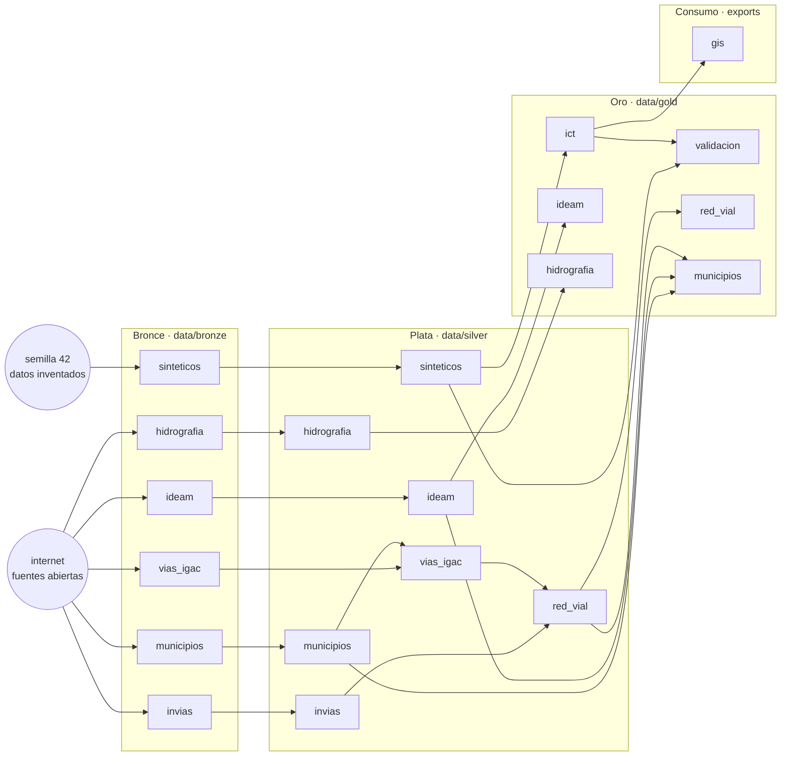

# Pipeline de datos del piloto · arquitectura medallion

Este documento explica cómo se arma, se ejecuta y se controla el pipeline de datos del piloto del Reto 5
(mapa de riesgos multicriterio de La Guajira). Las tablas marcadas como *automáticas* se regeneran desde el
código con `python -m documentar` (carpeta `src/`), así que no pueden quedar desactualizadas.

> **Qué es real y qué es inventado.** El piloto mezcla dos tipos de datos. Los **sintéticos** (proyectos,
> paquetes de trabajo, comunidades, áreas protegidas, registro de riesgos y el clima que alimenta el ICT) los
> genera `bronce.sinteticos` con semilla 42 y no representan información de Ecopetrol. Los **reales** vienen de
> fuentes abiertas sin clave: clima del IDEAM, red vial de INVIAS e IGAC, hidrografía del IGAC y límites
> municipales del DANE. Cada producto lleva su etiqueta de origen en el mapa y en la página *Datos y modelo*.

## 1. Contrato de las capas

| | **Bronce** `data/bronze` | **Plata** `data/silver` | **Oro** `data/gold` | **Consumo** |
|---|---|---|---|---|
| **Qué contiene** | Los datos tal como llegan de la fuente | Datos limpios, validados y conformados | Productos listos para usar, uno por necesidad | Salidas para personas y otros programas |
| **Quién escribe** | Solo `bronce.*` | Solo `plata.*` | Solo `oro.*` | `app/` y `consumo.*` |
| **Qué lee** | Internet (fuentes abiertas) o el generador sintético | Bronce (y Plata de otra fuente) | **Solo Plata** (el paso de validación también lee el ICT que acaba de calcular) | Solo Oro (la API también lee Plata para recalcular el ICT) |
| **Se edita a mano** | Nunca; se reemplaza al volver a descargar | Nunca; se regenera | Nunca; se regenera | — |
| **Formato** | El original (CSV, Parquet con texto, GeoJSON) | Parquet y GeoJSON con tipos, unidades y CRS conformados | GeoJSON estricto (sin `NaN`), CSV y JSON | GeoPackage, API REST, mapa |
| **Acompañamiento** | `*_meta.json`: fuente, licencia, fecha de descarga, caja | `reporte_calidad_*.csv` y `proveniencia_*.json` | Bloque `metadata` dentro de cada archivo: fuente, licencia, fecha | — |

Reglas que el código hace cumplir (y que `auditoria.py` y `tests/test_arquitectura.py` verifican):

1. **Solo Bronce toca la red.** Ningún módulo de Plata, Oro o Consumo importa `urllib`, `requests` ni `comun.http`.
2. **Oro no lee Bronce.** Lo que Oro necesita saber del origen (fuente, licencia, fecha) viaja en el archivo
   `proveniencia_<fuente>.json` que escribe Plata. Por eso Plata guarda también datos intermedios que Oro usa
   (por ejemplo, las lecturas horarias limpias, de donde Oro calcula el promedio de 24 horas).
3. **Plata no lee Oro; Bronce no lee nada derivado.** El flujo va en un solo sentido.
4. **Cada artefacto lo escribe un solo paso.** Si dos pasos escribieran el mismo archivo, el resultado dependería del orden.
5. **Cada paso reemplaza sus salidas completas** (es idempotente): correrlo dos veces con las mismas entradas da lo mismo.
6. **Las descargas son opcionales**: si una fuente abierta falla, el pipeline avisa y sigue con lo último que se bajó de ella.
   Los pasos sintéticos y el cálculo del ICT sí son obligatorios.

## 2. Mapa del pipeline <small>(automático)</small>

<!-- AUTO:diagrama -->

<!-- /AUTO:diagrama -->

## 3. Pasos, en orden de ejecución <small>(automático)</small>

El orden no está escrito a mano: sale de lo que cada paso lee y escribe (`src/pipeline.py`). Un paso corre
después de todos los que escriben algo que él lee.

<!-- AUTO:pasos -->
| # | Paso (módulo) | Capa | Qué hace | Lee | Escribe | Red |
|---|---|---|---|---|---|---|
| 1 | `bronce.sinteticos` | Bronce | Genera los datos sintéticos de entrada (proyectos, riesgos, clima simulado), sucios a propósito | — | `bronce:sinteticos` | no |
| 2 | `bronce.ideam` | Bronce | Descarga el clima real del IDEAM: catálogo, lluvia, temperatura, humedad, viento, presión, nivel, radiación y normales | — | `bronce:ideam` | sí |
| 3 | `bronce.invias` | Bronce | Descarga la Red Vial Nacional de INVIAS (solo lo que cruza La Guajira) | — | `bronce:invias` | sí |
| 4 | `bronce.vias_igac` | Bronce | Descarga la red vial completa del IGAC 1:100.000 (7 capas) | — | `bronce:vias_igac` | sí |
| 5 | `bronce.hidrografia` | Bronce | Descarga ríos, ciénagas, lagunas y embalses del IGAC 1:100.000 | — | `bronce:hidrografia` | sí |
| 6 | `bronce.municipios` | Bronce | Descarga los límites municipales del DANE y el DIVIPOLA | — | `bronce:municipios` | sí |
| 7 | `plata.sinteticos` | Plata | Limpia el registro de riesgos: duplicados, taxonomía y geolocalización inferida | `bronce:sinteticos` | `plata:sinteticos` | no |
| 8 | `plata.ideam` | Plata | Clasifica lecturas por sensor, quita duplicados e imposibles, unifica unidades y agrega por día | `bronce:ideam` | `plata:ideam` | no |
| 9 | `plata.invias` | Plata | Traduce dominios, quita tramos repetidos, recorta y simplifica la red nacional | `bronce:invias` | `plata:invias` | no |
| 10 | `plata.hidrografia` | Plata | Une las 5 capas, repara y recorta geometrías y traduce el estado del cauce | `bronce:hidrografia` | `plata:hidrografia` | no |
| 11 | `plata.municipios` | Plata | Nombres propios, código DANE, área en metros y geometría simplificada sin huecos | `bronce:municipios` | `plata:municipios` | no |
| 12 | `plata.vias_igac` | Plata | Une las 7 capas de vías, traduce dominios y recorta al departamento (municipios del DANE) | `bronce:vias_igac`, `plata:municipios` | `plata:vias_igac` | no |
| 13 | `plata.red_vial` | Plata | Une INVIAS e IGAC en una red sin duplicados y completa la superficie de INVIAS | `plata:invias`, `plata:vias_igac` | `plata:red_vial` | no |
| 14 | `oro.ict` | Oro | Calcula el ICT, el índice de oportunidad, el escalamiento, el mapa de calor y los puntos calientes | `plata:sinteticos` | `oro:ict` | no |
| 15 | `oro.validacion` | Oro | Backtest (circular) y sensibilidad de los pesos del modelo | `plata:sinteticos`, `oro:ict` | `oro:validacion` | no |
| 16 | `oro.ideam` | Oro | Una ficha por estación con todas sus variables, lo de ahora y las normales; puntos de radiación | `plata:ideam` | `oro:ideam` | no |
| 17 | `oro.hidrografia` | Oro | Capas de ríos (líneas) y cuerpos de agua (polígonos) para el mapa | `plata:hidrografia` | `oro:hidrografia` | no |
| 18 | `oro.red_vial` | Oro | Capa de vías para el mapa: red nacional y complementaria, distinguidas por fuente | `plata:red_vial` | `oro:red_vial` | no |
| 19 | `oro.municipios` | Oro | Municipios con estaciones del IDEAM y km de vías dentro; contorno departamental | `plata:municipios`, `plata:ideam`, `plata:red_vial` | `oro:municipios` | no |
| 20 | `consumo.exportar_gis` | Consumo | Exporta la capa Oro del modelo a GeoPackage y GeoJSON para ArcGIS o QGIS | `oro:ict` | `consumo:gis` | no |
<!-- /AUTO:pasos -->

## 4. Cómo ejecutarlo

Todo se corre desde la carpeta `piloto/`. No hace falta clave ni registro para ninguna fuente.

```bash
python ejecutar_pipeline.py                       # todo, en orden (descarga: ~10 min la primera vez)
python ejecutar_pipeline.py --sin-red             # todo lo local, con el Bronce que ya hay
python ejecutar_pipeline.py --capa plata          # solo una capa: bronce, plata, oro o consumo
python ejecutar_pipeline.py --fuente ideam        # una fuente y todo lo que depende de ella
python ejecutar_pipeline.py --fuente municipios --solo-esto   # solo esa fuente, sin lo que depende
python ejecutar_pipeline.py --lista               # muestra el plan sin ejecutar nada
python ejecutar_pipeline.py --auditar             # al terminar, revisa la coherencia de las tres capas
python ejecutar_pipeline.py --limpiar-huerfanos   # borra archivos de data/ que ningún paso declara
python -m auditoria                               # (desde src/) solo la auditoría
python -m documentar                              # (desde src/) regenera las tablas automáticas de este documento
```

`--fuente X` es conservador a propósito: además de la fuente pedida repite los pasos que **leen lo que ella
produce**. Por ejemplo, `--fuente municipios` repite también `plata.vias_igac` (que recorta las vías al
contorno de los municipios), `plata.red_vial`, `oro.red_vial` y `oro.municipios`. Fuentes disponibles:
`sinteticos`, `ideam`, `invias`, `vias_igac`, `hidrografia`, `municipios`, `red_vial`, `ict`, `validacion`.

Cada paso es también un módulo que se puede correr solo desde `src/`: `python -m plata.ideam`.
Para probar el pipeline completo **sin tocar los datos existentes**, apunta a otra carpeta:

```bash
set PILOTO_DATA=C:\ruta\prueba          # Windows;  en Mac/Linux: export PILOTO_DATA=/ruta/prueba
python ejecutar_pipeline.py --auditar
```

## 5. Fuentes y reglas de cada capa

### 5.1 Clima real del IDEAM

| | |
|---|---|
| **Fuente** | Portal de datos abiertos datos.gov.co (API Socrata, sin clave). Un conjunto por variable, el catálogo de estaciones, radiación, normales climatológicas y el flujo de las últimas horas. Licencia CC BY-SA 4.0. |
| **Bronce** (`bronce.ideam`) | `ideam_estaciones.csv`, `ideam_precipitacion.parquet`, `ideam_variables.parquet` (con la columna `variable` = conjunto de origen), `ideam_radiacion.csv`, `ideam_normales.csv`, `ideam_ultimas_horas.parquet`, `ideam_meta.json`. Todo como texto, con duplicados. Las consultas agregadas sobre todo el histórico se agotan, así que se sondea estación por estación y se baja solo la ventana de 30 días. |
| **Plata** (`plata.ideam`) | Códigos de estación a 10 dígitos; fechas y números tipados. **El catálogo del portal llega con hasta 3 copias de cada estación** (el mismo código con y sin ceros a la izquierda) y a veces con copias que se contradicen en el estado (una "Activa" y otra "Suspendida"): tras normalizar el código se deja la primera copia y el reporte de calidad cuenta las copias quitadas y las contradicciones. **Cada lectura se clasifica por su sensor, no por el conjunto de donde vino** (el de "humedad" trae humedad del suelo; el de temperatura, temperatura del suelo). Se descartan los sensores que no se usan, los valores sin fecha o sin número y los que caen fuera del rango físico (p. ej. lluvia 0–200 mm por lectura, temperatura −5 a 50 °C, viento 0–60 m/s, presión 500–1100 hPa; los centinelas 999 y 1000 del viento salen por aquí). Unidades unificadas (`hPA`→`hPa`, `mt`→`m`, `GN`/`deg`→`°`; el nivel del río, rotulado `cm` pero en metros, se lleva a metros salvo el limnímetro de las 6 y 18 h, que sí viene en centímetros). **Duplicados:** en lluvia se conserva el mayor valor por (estación, instante) porque los canales repetidos no se suman; en las demás variables se promedia. **Agregación diaria:** la lluvia se suma; las demás variables dan media, mínimo y máximo; la dirección del viento se promedia como vector (350° y 10° dan 0°, no 180°). Se descartan estaciones fuera de La Guajira (caja con margen de 0,6°). La radiación se empareja con el catálogo por nombre y municipio (6 de 7 estaciones); las normales traen el código de la estación y se conserva el periodo más reciente de cada parámetro. |
| **Oro** (`oro.ideam`) | `clima_estaciones.geojson`: un punto por estación con datos, con lluvia a 7/14/30 días, y por variable la última lectura, el promedio de 24 h, mín/media/máx de 30 días, la serie diaria, lo último de las últimas horas, la normal del mes y la radiación media. `clima_radiacion.geojson`: puntos de radiación. |
| **Consumo** | Capas "Clima" del mapa (una por variable) y `/api/clima`. Además `app/clima_vivo.py` consulta el flujo de últimas horas en vivo (caché de 10 min) y le aplica la **misma limpieza de Plata** (`plata.ideam.limpiar_ultimas_horas`); es el único camino que no pasa por las capas y está pensado así: lectura en tiempo casi real, con respaldo en `silver/ideam_ultimas_horas.parquet`. |
| **Supuestos** | `valorobservado` de lluvia son los mm caídos en el intervalo de cada lectura. Las unidades de las normales no vienen en la tabla; se asignan las habituales del IDEAM. La humedad del aire solo tiene serie de 30 días en una estación; en las demás hay únicamente las últimas horas. |

### 5.2 Red vial: INVIAS + IGAC

| | |
|---|---|
| **Fuentes** | **INVIAS**, Red Vial Nacional (datos.gov.co `ie7y-asdn`, CC BY-SA 4.0): troncales, transversales y accesos a capitales. **IGAC**, cartografía básica 1:100.000 vía el servicio ArcGIS del IDEAM: seis tipos de vía y caminos. El uso del IGAC es libre **solo sin fines comerciales** (Resolución 364 de 2012). |
| **Bronce** (`bronce.invias`, `bronce.vias_igac`) | INVIAS: los tramos que cruzan la caja de La Guajira (la consulta `within_box` evita bajar 260 MB). IGAC: siete archivos, uno por capa del servicio, paginados de a 1.000 objetos y verificados contra el conteo que anuncia el servicio. |
| **Plata** (`plata.invias`, `plata.vias_igac`, `plata.red_vial`) | *INVIAS:* traduce los dominios (administrador, categoría, calzada), cambia los "Por Defnir" por vacío, quita los tramos cubiertos ≥95 % por otros, recorta, simplifica a 15 m y recalcula la longitud en metros. *IGAC:* une las siete capas, traduce superficie, ancho y accesibilidad, **recorta al contorno de los municipios del DANE**, simplifica a 20 m y descarta pedazos menores a 30 m. La fuente no explica los "tipos" 1–7; se nombraron por sus atributos, que son siempre los mismos dentro de cada tipo. *Unión (`plata.red_vial`):* conserva INVIAS completa (trae ruta, administrador y categoría), **quita del IGAC lo que queda a menos de 50 m de una vía de INVIAS** (la red nacional sale de la misma cartografía base, así que sumarlas contaría ~320 km dos veces) y descarta los pedazos menores a 100 m que quedan junto al borde; a cada tramo de INVIAS, que no trae superficie, le pone la del IGAC si una sola clase cubre ≥60 % de su longitud. |
| **Oro** (`oro.red_vial`) | `red_vial.geojson`: una sola tabla; la columna `fuente` (INVIAS / IGAC) y `estilo` distinguen cada red. |
| **Consumo** | Capa "Vías" del mapa (naranja = red nacional, rosa = complementaria, con interruptor por clase) y cifras de kilómetros por municipio. |
| **Supuestos** | Escala 1:100.000: puede faltar lo reciente. "Solo en tiempo seco" lo dice la fuente; no es una medición actual. La superficie de INVIAS completada desde el IGAC puede estar desactualizada. |

### 5.3 Hidrografía del IGAC

| | |
|---|---|
| **Fuente** | Cartografía básica 1:100.000 del IGAC (servicio ArcGIS del IDEAM): drenajes sencillos (líneas), drenajes principales (polígonos), ciénagas, embalses y lagunas. Uso libre solo sin fines comerciales. |
| **Bronce** (`bronce.hidrografia`) | Cinco archivos, uno por capa, tal como llegan (todos los atributos, sin simplificar). |
| **Plata** (`plata.hidrografia`) | Une las cinco capas con la columna `tipo`; repara geometrías inválidas (`make_valid`); recorta a la caja; simplifica a 25 m las líneas y 20 m los polígonos; traduce el estado del cauce (5101 permanente, 5102 intermitente); normaliza los nombres ("Rio" → "Río"). |
| **Oro** (`oro.hidrografia`) | `rios.geojson` (líneas) y `cuerpos_agua.geojson` (polígonos con su área en km²). |
| **Supuestos** | El estado "permanente/intermitente" es la clasificación del IGAC a esa escala, no una medición de caudal. La cartografía muestra el contorno de lagunas y jagüeyes, no si hoy hay agua. |

### 5.4 Municipios del DANE

| | |
|---|---|
| **Fuente** | Marco Geoestadístico Nacional del DANE (capa de municipios, versión 2005, vía un servicio de Esri Colombia) y el DIVIPOLA de datos.gov.co para nombres y cabeceras. |
| **Bronce** (`bronce.municipios`) | Los 15 polígonos con todos sus atributos (más de 200 columnas del censo) y el DIVIPOLA. |
| **Plata** (`plata.municipios`) | Nombre propio ("La Jagua del Pilar"), código DANE de 5 dígitos, área recalculada en metros (EPSG:3116), punto interior para escribir el nombre, y **simplificación topológica compartida** (`coverage_simplify`, ≈45 m) que no abre huecos entre vecinos. Control: el reporte de calidad registra las partes del departamento (debe ser 1), los huecos entre municipios y la mayor diferencia de área con la oficial. |
| **Oro** (`oro.municipios`) | `municipios.geojson` con sus cifras, que salen de **cruzar espacialmente** fuentes de Plata: estaciones del IDEAM dentro (por ubicación, no por el municipio que declara el catálogo) y kilómetros de vías. `limite_departamental.geojson` (la unión de los 15) y `reporte_cruces_municipios.csv` con lo que encontró el cruce (estaciones fuera de los polígonos o en otro municipio). |

### 5.5 Datos sintéticos y el modelo ICT

| | |
|---|---|
| **Bronce** (`bronce.sinteticos`) | Proyectos, paquetes de trabajo, comunidades, áreas protegidas, hidrología, vías, clima simulado y el registro de riesgos en Excel, con semilla 42 y **sucios a propósito** (duplicados, nulos, texto inconsistente, ~12 % sin coordenadas). |
| **Plata** (`plata.sinteticos`) | Normaliza taxonomía, estados y tipos; quita duplicados; ubica los riesgos sin coordenadas en el centroide de su paquete y los marca con `geolocalizacion_inferida`. |
| **Oro** (`oro.ict`, `oro.validacion`) | Índice de Criticidad Territorial por paquete (cinco criterios con los pesos de `parametros.yaml`), índice de oportunidad, reglas de escalamiento a crisis, mapa de calor (KDE), puntos calientes (Getis-Ord Gi*), alertas, backtest y sensibilidad de los pesos. |
| **Ubicación** | Todo cae dentro de La Guajira y a tierra firme: puntos a más de ~2 km de la costa y la frontera; áreas, arroyos y vías enteros dentro. Los tres proyectos (norte, centro y sur) quedan en el punto más cercano a su zona donde cabe un círculo de ~21 km de radio, y sus paquetes dentro de él. Se usa el contorno `src/comun/contorno_guajira.wkt` (15 municipios del DANE, simplificados a ~1 km) para que los datos sintéticos se generen sin conexión y de forma reproducible. Un margen de 0,012° absorbe la simplificación, así que lo ubicado también queda dentro del límite oficial completo. |
| **Supuestos** | El backtest es **circular** (los eventos sintéticos se generaron con las mismas variables que usa el modelo): confirma el mecanismo, no que pesos y criterios sean los correctos. El ICT se calcula "a la fecha de hoy"; por eso corridas en días distintos dan tendencias distintas. El criterio climático del ICT usa el clima **simulado**, no el del IDEAM. |

## 6. Convenciones transversales

- **Coordenadas:** todo se almacena y se sirve en EPSG:4326 (grados). Las longitudes y áreas se calculan en
  EPSG:3116 (MAGNA-SIRGAS / Colombia Bogotá, metros) y se vuelve a 4326. Los recortes se hacen **en grados**
  (una caja o un borde reproyectados a metros dejan de ser un rectángulo y cortan torcido).
- **Simplificación:** se aplica antes de comparar geometrías entre sí (compararlas con 10 mil vértices tarda minutos) y siempre
  después de reparar y recortar. La tolerancia de cada fuente está en la sección 5.
- **JSON estricto:** los productos Oro se escriben con `allow_nan=False` y NaN→`null`; un `NaN` suelto rompe la API y el mapa.
- **Nombres:** `bronce.<fuente>` → `plata.<fuente>` → `oro.<fuente>`; archivos en minúsculas y snake_case; sin tildes en nombres de archivo.
- **Codificación:** UTF-8 en archivos de texto; las columnas de texto de Bronce se conservan como llegan.
- **Fechas:** la fecha de descarga queda en el `*_meta.json` y se propaga a Plata y Oro; las ventanas de datos (`desde`, `hasta`) también.
- **Determinismo:** los datos sintéticos usan semilla 42; los reales cambian con cada descarga.
- **Una sola fuente de verdad del orden:** `src/pipeline.py`. Para agregar o mover un paso se edita ahí.

## 7. Control de calidad y auditoría

Cada paso de Plata escribe `reporte_calidad_<fuente>.csv` (una fila de contadores: lo que entró, lo que se
descartó y por qué, lo que salió) y `proveniencia_<fuente>.json`. `python -m auditoria` (o `--auditar`) revisa
seis cosas y guarda el detalle en `data/auditoria_pipeline.csv`:

| Grupo | Qué comprueba |
|---|---|
| **reglas** | El código respeta las capas (sección 1): ningún módulo lee una capa que no le toca ni usa la red fuera de Bronce. |
| **artefactos** | Cada archivo que declara un paso existe, se lee, no está vacío; los geográficos están en EPSG:4326 con geometrías válidas y no vacías en Plata y Oro; los JSON de Oro no traen `NaN`. |
| **trazabilidad** | Los productos Oro de fuentes externas dicen su fuente, licencia y fecha de descarga. |
| **conciliación** | Las cuentas cuadran entre capas. Por ejemplo: lecturas de Bronce − duplicados − imposibles − sin dato = lecturas de Plata; objetos de hidrografía de Bronce − sin geometría − fuera de la caja − vacíos = objetos de Plata; km de INVIAS + km del IGAC − repetidos − astillas = km de la red unificada (±1 km); rios + cuerpos de agua en Oro = objetos de Plata; una ficha de clima por estación con datos en Plata. |
| **geografía** | Todo lo inventado (proyectos, paquetes, comunidades, áreas, arroyos, vías, riesgos y estaciones simuladas) cae dentro del límite de La Guajira (el de los municipios del DANE en Plata, o el contorno de referencia si aún no se descargó). |
| **huérfanos** | Archivos en `data/` que ningún paso escribe (restos de versiones anteriores); `--limpiar-huerfanos` los borra. |

La auditoría termina con código 1 si hay algún **ERROR**, para poder usarla como puerta antes de publicar.
Las **ALERTAS** (hoy, solo huérfanos) no detienen nada.

Pruebas automáticas: `python -m pytest tests` corre las pruebas de cada limpieza (con datos mínimos inventados),
las reglas de capas (incluyendo que *detectan* los cruces prohibidos) y la consistencia de la definición del pipeline.

## 8. Inventario de datos <small>(automático, de lo que hay hoy en `data/`)</small>

<!-- AUTO:inventario -->
**Bronce** (`data/bronze`): 34 archivos, 51.3 MB

<details><summary>Ver archivos</summary>

| Artefacto | Archivo | Formato | Filas | Tamaño |
|---|---|---|---:|---:|
| `sinteticos` | `proyectos.geojson` | geojson | 3 | 9 KB |
| `sinteticos` | `paquetes_trabajo.geojson` | geojson | 14 | 44 KB |
| `sinteticos` | `comunidades.geojson` | geojson | 18 | 5 KB |
| `sinteticos` | `areas_protegidas.geojson` | geojson | 6 | 19 KB |
| `sinteticos` | `hidrologia.geojson` | geojson | 8 | 3 KB |
| `sinteticos` | `vias.geojson` | geojson | 10 | 2 KB |
| `sinteticos` | `clima_sintetico.csv` | csv | 600 | 42 KB |
| `sinteticos` | `registro_riesgos.xlsx` | xlsx | 212 | 27 KB |
| `ideam` | `ideam_estaciones.csv` | csv | 219 | 107 KB |
| `ideam` | `ideam_meta.json` | json | 1 | 6 KB |
| `ideam` | `ideam_normales.csv` | csv | 420 | 65 KB |
| `ideam` | `ideam_precipitacion.parquet` | parquet | 65.123 | 227 KB |
| `ideam` | `ideam_radiacion.csv` | csv | 7 | 1 KB |
| `ideam` | `ideam_ultimas_horas.parquet` | parquet | 3.041 | 32 KB |
| `ideam` | `ideam_variables.parquet` | parquet | 195.350 | 731 KB |
| `invias` | `invias_meta.json` | json | 1 | 0 KB |
| `invias` | `invias_red_vial.geojson` | geojson | 11 | 2.8 MB |
| `vias_igac` | `igac_via_caminos.geojson` | geojson | 1.944 | 3.9 MB |
| `vias_igac` | `igac_via_tipo1.geojson` | geojson | 35 | 135 KB |
| `vias_igac` | `igac_via_tipo2.geojson` | geojson | 13 | 29 KB |
| `vias_igac` | `igac_via_tipo3.geojson` | geojson | 241 | 197 KB |
| `vias_igac` | `igac_via_tipo4.geojson` | geojson | 73 | 238 KB |
| `vias_igac` | `igac_via_tipo5.geojson` | geojson | 256 | 825 KB |
| `vias_igac` | `igac_via_tipo6.geojson` | geojson | 3.041 | 5.4 MB |
| `vias_igac` | `vias_igac_meta.json` | json | 1 | 1 KB |
| `hidrografia` | `igac_drenaje_doble.geojson` | geojson | 32 | 2.7 MB |
| `hidrografia` | `igac_drenaje_sencillo.geojson` | geojson | 9.612 | 28.1 MB |
| `hidrografia` | `igac_cienagas.geojson` | geojson | 9 | 43 KB |
| `hidrografia` | `igac_embalses.geojson` | geojson | 3 | 19 KB |
| `hidrografia` | `igac_lagunas.geojson` | geojson | 174 | 383 KB |
| `hidrografia` | `hidrografia_meta.json` | json | 1 | 1 KB |
| `municipios` | `dane_municipios.geojson` | geojson | 15 | 5.3 MB |
| `municipios` | `divipola_municipios.csv` | csv | 15 | 1 KB |
| `municipios` | `municipios_meta.json` | json | 1 | 0 KB |

</details>

**Plata** (`data/silver`): 33 archivos, 13.8 MB

<details><summary>Ver archivos</summary>

| Artefacto | Archivo | Formato | Filas | Tamaño |
|---|---|---|---:|---:|
| `sinteticos` | `riesgos.geojson` | geojson | 200 | 153 KB |
| `sinteticos` | `paquetes.geojson` | geojson | 14 | 44 KB |
| `sinteticos` | `proyectos.geojson` | geojson | 3 | 9 KB |
| `sinteticos` | `comunidades.geojson` | geojson | 18 | 5 KB |
| `sinteticos` | `areas.geojson` | geojson | 6 | 19 KB |
| `sinteticos` | `hidro.geojson` | geojson | 8 | 3 KB |
| `sinteticos` | `vias.geojson` | geojson | 10 | 2 KB |
| `sinteticos` | `clima_sintetico.parquet` | parquet | 600 | 10 KB |
| `sinteticos` | `reporte_calidad_bronce_a_plata.csv` | csv | 1 | 0 KB |
| `ideam` | `ideam_estaciones.geojson` | geojson | 219 | 162 KB |
| `ideam` | `ideam_normales.parquet` | parquet | 101 | 24 KB |
| `ideam` | `ideam_precip_diaria.parquet` | parquet | 310 | 5 KB |
| `ideam` | `ideam_radiacion.parquet` | parquet | 7 | 13 KB |
| `ideam` | `ideam_ultimas_horas.parquet` | parquet | 2.849 | 11 KB |
| `ideam` | `ideam_variables_diaria.parquet` | parquet | 2.039 | 24 KB |
| `ideam` | `ideam_variables_horaria.parquet` | parquet | 189.646 | 826 KB |
| `ideam` | `reporte_calidad_ideam.csv` | csv | 1 | 1 KB |
| `ideam` | `proveniencia_ideam.json` | json | 1 | 5 KB |
| `invias` | `invias_red_vial.geojson` | geojson | 9 | 16 KB |
| `invias` | `reporte_calidad_invias.csv` | csv | 1 | 0 KB |
| `invias` | `proveniencia_invias.json` | json | 1 | 1 KB |
| `vias_igac` | `igac_vias.geojson` | geojson | 5.326 | 3.0 MB |
| `vias_igac` | `reporte_calidad_vias_igac.csv` | csv | 1 | 0 KB |
| `vias_igac` | `proveniencia_vias_igac.json` | json | 1 | 2 KB |
| `hidrografia` | `igac_hidrografia.geojson` | geojson | 9.823 | 5.3 MB |
| `hidrografia` | `reporte_calidad_hidrografia.csv` | csv | 1 | 0 KB |
| `hidrografia` | `proveniencia_hidrografia.json` | json | 1 | 1 KB |
| `municipios` | `municipios.geojson` | geojson | 15 | 347 KB |
| `municipios` | `reporte_calidad_municipios.csv` | csv | 1 | 0 KB |
| `municipios` | `proveniencia_municipios.json` | json | 1 | 1 KB |
| `red_vial` | `red_vial.geojson` | geojson | 5.278 | 3.9 MB |
| `red_vial` | `reporte_calidad_red_vial.csv` | csv | 1 | 0 KB |
| `red_vial` | `proveniencia_red_vial.json` | json | 1 | 2 KB |

</details>

**Oro** (`data/gold`): 19 archivos, 9.2 MB

<details><summary>Ver archivos</summary>

| Artefacto | Archivo | Formato | Filas | Tamaño |
|---|---|---|---:|---:|
| `ict` | `paquetes_ict.geojson` | geojson | 14 | 53 KB |
| `ict` | `grid_calor.geojson` | geojson | 620 | 101 KB |
| `ict` | `alertas.json` | json | 4 | 1 KB |
| `ict` | `riesgos.geojson` | geojson | 200 | 153 KB |
| `ict` | `proyectos.geojson` | geojson | 3 | 9 KB |
| `ict` | `comunidades.geojson` | geojson | 18 | 5 KB |
| `ict` | `areas.geojson` | geojson | 6 | 19 KB |
| `ict` | `hidro.geojson` | geojson | 8 | 3 KB |
| `ict` | `vias.geojson` | geojson | 10 | 2 KB |
| `validacion` | `validacion_backtest.csv` | csv | 14 | 0 KB |
| `validacion` | `validacion_sensibilidad.csv` | csv | 10 | 0 KB |
| `ideam` | `clima_estaciones.geojson` | geojson | 14 | 202 KB |
| `ideam` | `clima_radiacion.geojson` | geojson | 7 | 3 KB |
| `hidrografia` | `rios.geojson` | geojson | 9.605 | 4.2 MB |
| `hidrografia` | `cuerpos_agua.geojson` | geojson | 218 | 282 KB |
| `red_vial` | `red_vial.geojson` | geojson | 5.278 | 3.7 MB |
| `municipios` | `municipios.geojson` | geojson | 15 | 321 KB |
| `municipios` | `limite_departamental.geojson` | geojson | 1 | 111 KB |
| `municipios` | `reporte_cruces_municipios.csv` | csv | 1 | 0 KB |

</details>

**Consumo** (`exports`): 9 archivos, 767 KB

<details><summary>Ver archivos</summary>

| Artefacto | Archivo | Formato | Filas | Tamaño |
|---|---|---|---:|---:|
| `gis` | `areas_protegidas.geojson` | geojson |  | 19 KB |
| `gis` | `comunidades.geojson` | geojson |  | 5 KB |
| `gis` | `grid_calor.geojson` | geojson |  | 101 KB |
| `gis` | `hidrologia.geojson` | geojson |  | 3 KB |
| `gis` | `paquetes_ict.geojson` | geojson |  | 53 KB |
| `gis` | `proyectos.geojson` | geojson |  | 9 KB |
| `gis` | `reto5_piloto.gpkg` | gpkg |  | 426 KB |
| `gis` | `riesgos.geojson` | geojson |  | 149 KB |
| `gis` | `vias.geojson` | geojson |  | 2 KB |

</details>

<!-- /AUTO:inventario -->

## 9. Cómo agregar una fuente nueva

1. **Bronce** — `src/bronce/<fuente>.py` con `main()`: descarga con `comun.http` (reintentos y User-Agent ya resueltos) y escribe en
   `BRONCE` los datos tal como llegan más `<fuente>_meta.json` (fuente, licencia, `descargado_en`, parámetros de la consulta).
2. **Plata** — `src/plata/<fuente>.py` con funciones `limpiar(...)` puras (reciben y devuelven DataFrames y un dict de contadores,
   fáciles de probar) y `main()` que lee Bronce, escribe en `PLATA`, guarda `reporte_calidad_<fuente>.csv` y llama a
   `escribir_proveniencia("<fuente>", meta, reporte)`. Registra en el reporte cada descarte, con nombre, para que la auditoría cuadre las cuentas.
3. **Oro** — `src/oro/<fuente>.py`: lee **solo** Plata (y `leer_proveniencia`), arma el producto y lo escribe con
   `escribir_coleccion`/`escribir_json` (que ponen el bloque `metadata` y rechazan `NaN`).
4. **Registro** — en `src/pipeline.py`: agrega los artefactos a `ARTEFACTOS` (con los patrones de archivo) y un `Paso` por módulo,
   con `lee` y `escribe`. El orden y las dependencias salen solos.
5. **Pruebas** — un `tests/test_<fuente>.py` con datos mínimos inventados que cubra cada regla de limpieza.
6. **Catálogo y documentación** — descripciones en `app/catalogo.py` (aparecen en *Datos y modelo*), `python -m documentar`, y una
   subsección en la sección 5 de este documento.
7. **Verifica** — `python ejecutar_pipeline.py --fuente <fuente> --auditar` debe terminar sin errores.

## 10. Limitaciones conocidas

- **Licencias.** Las capas del IGAC (ríos y vías) son de uso libre solo sin fines comerciales; si el piloto pasa a producción hay que
  acordar licencia con el IGAC o cambiar de fuente. No se verificó la licencia del servicio de Esri que publica los municipios del DANE.
- **El ICT todavía no usa los datos reales.** Su criterio de amenazas externas usa el clima simulado y su accesibilidad, las vías inventadas.
- **Geografía sintética.** Lo inventado se ubica sobre tierra firme de La Guajira, pero no sobre la geografía real: los proyectos no siguen
  las vías reales ni los riesgos las zonas reales de amenaza. Es una limitación de diseño, no un error de ubicación.
- **Municipios versión 2005.** Los bordes pueden diferir de los vigentes.
- **Las fuentes cambian.** Los servicios abiertos pueden tardar, agotarse o cambiar de esquema; las descargas reintentan, y si una falla
  el pipeline sigue con la última descarga y lo dice. Una descarga nueva puede dar cifras distintas (el clima cambia a diario).
- **El Bronce de las fuentes abiertas no se versiona:** se reemplaza al volver a descargar. Para reproducir una corrida exacta hay que conservar
  la carpeta `data/bronze` (el `*_meta.json` dice cuándo se bajó).
