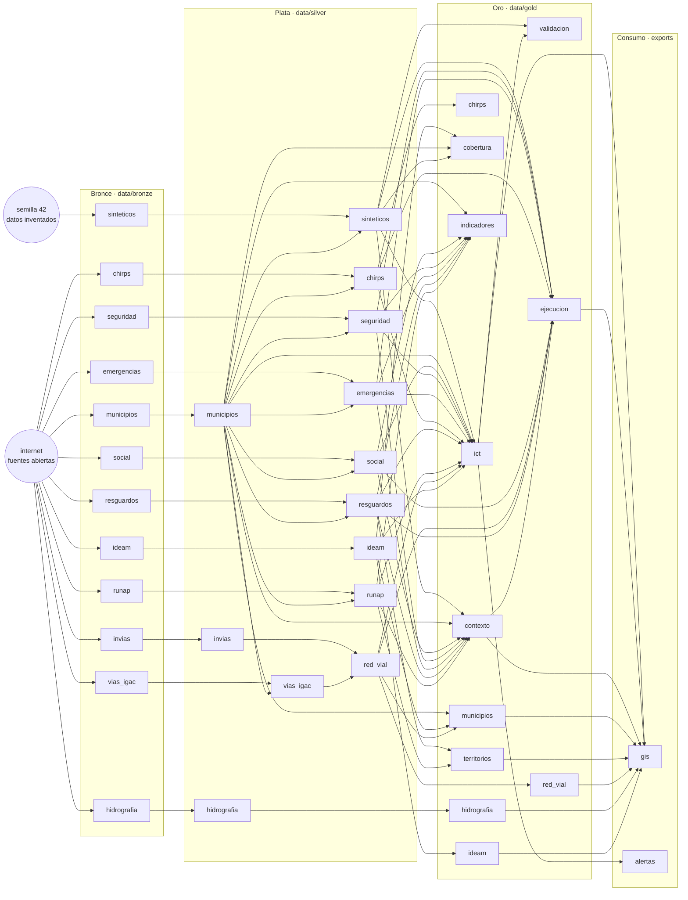

# Pipeline de datos del piloto · arquitectura medallion

Este documento explica cómo se arma, se ejecuta y se controla el pipeline de datos del piloto del Reto 5
(mapa de riesgos multicriterio de La Guajira). Las tablas marcadas como *automáticas* se regeneran desde el
código con `python -m documentar` (carpeta `src/`), así que no pueden quedar desactualizadas.

> **Qué es real y qué es inventado.** El piloto mezcla dos tipos de datos. Los **sintéticos** (proyectos,
> paquetes de trabajo, su cronograma y el registro de riesgos, con su texto) los genera `bronce.sinteticos` con
> semilla 42 y no representan información de Ecopetrol. Los **reales** vienen de fuentes abiertas sin clave: clima
> del IDEAM y de CHIRPS, red vial de INVIAS e IGAC, hidrografía del IGAC, municipios y censo del DANE, resguardos
> (ANT), áreas protegidas (RUNAP), delitos (Ministerio de Defensa) y emergencias (UNGRD). **El ICT cruza los dos**:
> el registro sintético con el territorio real. Cada producto lleva su etiqueta de origen en el mapa y en *Datos*.

## 1. Contrato de las capas

| | **Bronce** `data/bronze` | **Plata** `data/silver` | **Oro** `data/gold` | **Consumo** |
|---|---|---|---|---|
| **Qué contiene** | Los datos tal como llegan de la fuente | Datos limpios, validados y conformados | Productos listos para usar, uno por necesidad | Salidas para personas y otros programas |
| **Quién escribe** | Solo `bronce.*` | Solo `plata.*` | Solo `oro.*` | `app/` y `consumo.*` |
| **Qué lee** | Internet (fuentes abiertas) o el generador sintético | Bronce (y Plata de otra fuente) | **Solo Plata** (el paso de validación también lee el ICT que acaba de calcular) | Solo Oro (la API también lee Plata para recalcular el ICT) |
| **Se edita a mano** | Nunca; se reemplaza al volver a descargar | Nunca; se regenera | Nunca; se regenera | — |
| **Formato** | El original (CSV, Parquet con texto, GeoJSON) | Parquet y GeoJSON con tipos, unidades y CRS conformados | GeoJSON estricto (sin `NaN`), CSV y JSON | GeoPackage, API REST, mapa |
| **Acompañamiento** | `*_meta.json`: fuente, licencia, fecha de descarga, caja | `reporte_calidad_*.csv` y `proveniencia_*.json` | Bloque `metadata` dentro de cada archivo: fuente, licencia, fecha | — |

Reglas que el código hace cumplir (y que `auditoria.py` y `tests/test_arquitectura.py` verifican):

1. **Solo Bronce toca la red.** Ningún módulo de Plata, Oro o Consumo importa `urllib`, `requests` ni `comun.http`.
2. **Oro no lee Bronce.** Lo que Oro necesita saber del origen (fuente, licencia, fecha) viaja en el archivo
   `proveniencia_<fuente>.json` que escribe Plata. Por eso Plata guarda también datos intermedios que Oro usa
   (por ejemplo, las lecturas horarias limpias, de donde Oro calcula el promedio de 24 horas).
3. **Plata no lee Oro; Bronce no lee nada derivado.** El flujo va en un solo sentido.
4. **Cada artefacto lo escribe un solo paso.** Si dos pasos escribieran el mismo archivo, el resultado dependería del orden.
5. **Cada paso reemplaza sus salidas completas** (es idempotente): correrlo dos veces con las mismas entradas da lo mismo.
6. **Las descargas son opcionales**: si una fuente abierta falla, el pipeline avisa y sigue con lo último que se bajó de ella.
   Los pasos sintéticos y el cálculo del ICT sí son obligatorios.

## 2. Mapa del pipeline <small>(automático)</small>

<!-- AUTO:diagrama -->

<!-- /AUTO:diagrama -->

## 3. Pasos, en orden de ejecución <small>(automático)</small>

El orden no está escrito a mano: sale de lo que cada paso lee y escribe (`src/pipeline.py`). Un paso corre
después de todos los que escriben algo que él lee.

<!-- AUTO:pasos -->
| # | Paso (módulo) | Capa | Qué hace | Lee | Escribe | Red |
|---|---|---|---|---|---|---|
| 1 | `bronce.sinteticos` | Bronce | Genera los datos sintéticos de entrada (proyectos, riesgos, clima simulado), sucios a propósito | — | `bronce:sinteticos` | no |
| 2 | `bronce.ideam` | Bronce | Descarga el clima real del IDEAM: catálogo, lluvia, temperatura, humedad, viento, presión, nivel, radiación y normales | — | `bronce:ideam` | sí |
| 3 | `bronce.invias` | Bronce | Descarga la Red Vial Nacional de INVIAS (solo lo que cruza La Guajira) | — | `bronce:invias` | sí |
| 4 | `bronce.vias_igac` | Bronce | Descarga la red vial completa del IGAC 1:100.000 (7 capas) | — | `bronce:vias_igac` | sí |
| 5 | `bronce.hidrografia` | Bronce | Descarga ríos, ciénagas, lagunas y embalses del IGAC 1:100.000 | — | `bronce:hidrografia` | sí |
| 6 | `bronce.municipios` | Bronce | Descarga los límites municipales del DANE (MGN 2024) y el DIVIPOLA | — | `bronce:municipios` | sí |
| 7 | `bronce.social` | Bronce | Descarga los indicadores del censo 2018 por municipio (DANE), la calidad del agua (INS) y los PDET (ART) | — | `bronce:social` | sí |
| 8 | `bronce.resguardos` | Bronce | Descarga los resguardos indígenas (ANT) y su población (Ministerio del Interior) | — | `bronce:resguardos` | sí |
| 9 | `bronce.runap` | Bronce | Descarga las áreas protegidas del RUNAP (Parques Nacionales) | — | `bronce:runap` | sí |
| 10 | `bronce.seguridad` | Bronce | Descarga 11 delitos por municipio desde 2003 (Ministerio de Defensa) | — | `bronce:seguridad` | sí |
| 11 | `bronce.emergencias` | Bronce | Descarga las emergencias atendidas por la UNGRD (2019, 2020 y 2023 en adelante) | — | `bronce:emergencias` | sí |
| 12 | `bronce.chirps` | Bronce | Descarga la lluvia mensual de CHIRPS v3 (satélite + estaciones, ~5 km) sobre La Guajira desde 1991; solo los meses que falten | — | `bronce:chirps` | sí |
| 13 | `plata.ideam` | Plata | Clasifica lecturas por sensor, quita duplicados e imposibles, unifica unidades y agrega por día | `bronce:ideam` | `plata:ideam` | no |
| 14 | `plata.invias` | Plata | Traduce dominios, quita tramos repetidos, recorta y simplifica la red nacional | `bronce:invias` | `plata:invias` | no |
| 15 | `plata.hidrografia` | Plata | Une las 5 capas, repara y recorta geometrías y traduce el estado del cauce | `bronce:hidrografia` | `plata:hidrografia` | no |
| 16 | `plata.municipios` | Plata | Nombres propios, código DANE, área en metros y geometría simplificada sin huecos | `bronce:municipios` | `plata:municipios` | no |
| 17 | `plata.sinteticos` | Plata | Limpia el registro de riesgos: duplicados, taxonomía (con IA sobre el texto), matriz RAM y geolocalización inferida | `bronce:sinteticos`, `plata:municipios` | `plata:sinteticos` | no |
| 18 | `plata.vias_igac` | Plata | Une las 7 capas de vías, traduce dominios y recorta al departamento (municipios del DANE) | `bronce:vias_igac`, `plata:municipios` | `plata:vias_igac` | no |
| 19 | `plata.red_vial` | Plata | Une INVIAS e IGAC en una red sin duplicados y completa la superficie de INVIAS | `plata:invias`, `plata:vias_igac` | `plata:red_vial` | no |
| 20 | `plata.chirps` | Plata | Lluvia mensual por municipio: promedio de las celdas ponderado por el área que cae en cada municipio | `bronce:chirps`, `plata:municipios` | `plata:chirps` | no |
| 21 | `plata.social` | Plata | Une los indicadores del censo 2018 por municipio con nombres estables; IRCA por año; PDET | `bronce:social`, `plata:municipios` | `plata:social` | no |
| 22 | `plata.resguardos` | Plata | Repara y recorta los resguardos al departamento, normaliza el pueblo y une la población | `bronce:resguardos`, `plata:municipios` | `plata:resguardos` | no |
| 23 | `plata.runap` | Plata | Deja las áreas protegidas que tocan La Guajira, con ámbito (nacional, regional, privada) y área | `bronce:runap`, `plata:municipios` | `plata:runap` | no |
| 24 | `plata.seguridad` | Plata | Valida municipio y fecha de cada delito y agrega víctimas por municipio y mes | `bronce:seguridad`, `plata:municipios` | `plata:seguridad` | no |
| 25 | `plata.emergencias` | Plata | Armoniza los reportes de la UNGRD, corrige códigos de municipio, quita repetidos y agrupa el tipo de evento | `bronce:emergencias`, `plata:municipios` | `plata:emergencias` | no |
| 26 | `oro.ict` | Oro | Calcula el ICT con el territorio real, la oportunidad, el escalamiento, los puntos de crisis, el mapa de calor y las alertas | `plata:sinteticos`, `plata:municipios`, `plata:social`, `plata:seguridad`, `plata:emergencias`, `plata:chirps`, `plata:resguardos`, `plata:runap`, `plata:red_vial`, `plata:ideam` | `oro:ict` | no |
| 27 | `oro.validacion` | Oro | Backtest (circular) y sensibilidad de los pesos del modelo | `plata:sinteticos`, `oro:ict` | `oro:validacion` | no |
| 28 | `oro.ideam` | Oro | Una ficha por estación con todas sus variables, lo de ahora y las normales; puntos de radiación | `plata:ideam` | `oro:ideam` | no |
| 29 | `oro.hidrografia` | Oro | Capas de ríos (líneas) y cuerpos de agua (polígonos) para el mapa | `plata:hidrografia` | `oro:hidrografia` | no |
| 30 | `oro.red_vial` | Oro | Capa de vías para el mapa: red nacional y complementaria, distinguidas por fuente | `plata:red_vial` | `oro:red_vial` | no |
| 31 | `oro.municipios` | Oro | Municipios con estaciones del IDEAM y km de vías dentro; contorno departamental | `plata:municipios`, `plata:ideam`, `plata:red_vial` | `oro:municipios` | no |
| 32 | `oro.cobertura` | Oro | Extiende cada estacion a un area (mas cercana y radio por variable) y dice que estacion representa a cada paquete | `plata:ideam`, `plata:municipios`, `plata:sinteticos` | `oro:cobertura` | no |
| 33 | `oro.chirps` | Oro | Serie de los últimos años por municipio, normal 1991-2020 de cada mes y anomalía en % | `plata:chirps` | `oro:chirps` | no |
| 34 | `oro.territorios` | Oro | Capas de resguardos indígenas y áreas protegidas para el mapa | `plata:resguardos`, `plata:runap` | `oro:territorios` | no |
| 35 | `oro.indicadores` | Oro | Indicadores por municipio: censo 2018, agua, territorio étnico y protegido, delitos por mes y emergencias | `plata:municipios`, `plata:social`, `plata:seguridad`, `plata:emergencias`, `plata:resguardos`, `plata:runap` | `oro:indicadores` | no |
| 36 | `oro.contexto` | Oro | Contexto real de cada paquete: municipio, pobreza, resguardos y áreas protegidas cercanas, delitos y emergencias | `plata:sinteticos`, `plata:municipios`, `plata:social`, `plata:seguridad`, `plata:emergencias`, `plata:resguardos`, `plata:runap` | `oro:contexto` | no |
| 37 | `oro.ejecucion` | Oro | Riesgo de ejecución: Monte Carlo de días de atraso y USD de sobrecosto por paquete y proyecto (RAM + territorio) | `plata:sinteticos`, `plata:seguridad`, `plata:emergencias`, `plata:chirps`, `plata:social`, `plata:red_vial`, `plata:resguardos`, `oro:contexto` | `oro:ejecucion` | no |
| 38 | `consumo.exportar_gis` | Consumo | Exporta a GeoPackage y GeoJSON (ArcGIS o QGIS) el modelo, el territorio real y una tabla de origen de cada capa | `oro:ict`, `oro:ejecucion`, `oro:contexto`, `oro:municipios`, `oro:territorios`, `oro:red_vial`, `oro:hidrografia`, `oro:ideam` | `consumo:gis` | no |
| 39 | `consumo.alertas` | Consumo | Boletín diario de alertas tempranas: nuevas, que suben, siguen y resueltas frente al corte anterior | `oro:ict` | `consumo:alertas` | no |
<!-- /AUTO:pasos -->

## 4. Cómo ejecutarlo

Todo se corre desde la carpeta `piloto/`. No hace falta clave ni registro para ninguna fuente.

```bash
python ejecutar_pipeline.py                       # todo, en orden (descarga: ~10 min la primera vez)
python ejecutar_pipeline.py --sin-red             # todo lo local, con el Bronce que ya hay
python ejecutar_pipeline.py --capa plata          # solo una capa: bronce, plata, oro o consumo
python ejecutar_pipeline.py --fuente ideam        # una fuente y todo lo que depende de ella
python ejecutar_pipeline.py --fuente municipios --solo-esto   # solo esa fuente, sin lo que depende
python ejecutar_pipeline.py --lista               # muestra el plan sin ejecutar nada
python ejecutar_pipeline.py --auditar             # al terminar, revisa la coherencia de las tres capas
python ejecutar_pipeline.py --limpiar-huerfanos   # borra archivos de data/ que ningún paso declara
python -m auditoria                               # (desde src/) solo la auditoría
python -m documentar                              # (desde src/) regenera las tablas automáticas de este documento
```

`--fuente X` es conservador a propósito: además de la fuente pedida repite los pasos que **leen lo que ella
produce**. Por ejemplo, `--fuente municipios` repite también `plata.vias_igac` (que recorta las vías al
contorno de los municipios), `plata.red_vial`, `oro.red_vial` y `oro.municipios`. Fuentes disponibles:
`sinteticos`, `ideam`, `invias`, `vias_igac`, `hidrografia`, `municipios`, `red_vial`, `ict`, `validacion`.

Cada paso es también un módulo que se puede correr solo desde `src/`: `python -m plata.ideam`.
Para probar el pipeline completo **sin tocar los datos existentes**, apunta a otra carpeta:

```bash
set PILOTO_DATA=C:\ruta\prueba          # Windows;  en Mac/Linux: export PILOTO_DATA=/ruta/prueba
python ejecutar_pipeline.py --auditar
```

## 5. Fuentes y reglas de cada capa

### 5.1 Clima real del IDEAM

| | |
|---|---|
| **Fuente** | Portal de datos abiertos datos.gov.co (API Socrata, sin clave). Un conjunto por variable, el catálogo de estaciones, radiación, normales climatológicas y el flujo de las últimas horas. Licencia CC BY-SA 4.0. |
| **Bronce** (`bronce.ideam`) | `ideam_estaciones.csv`, `ideam_precipitacion.parquet`, `ideam_variables.parquet` (con la columna `variable` = conjunto de origen), `ideam_radiacion.csv`, `ideam_normales.csv`, `ideam_ultimas_horas.parquet`, `ideam_meta.json`. Todo como texto, con duplicados. Las consultas agregadas sobre todo el histórico se agotan, así que se sondea estación por estación y se baja solo la ventana de 30 días. |
| **Plata** (`plata.ideam`) | Códigos de estación a 10 dígitos; fechas y números tipados. **El catálogo del portal llega con hasta 3 copias de cada estación** (el mismo código con y sin ceros a la izquierda) y a veces con copias que se contradicen en el estado (una "Activa" y otra "Suspendida"): tras normalizar el código se deja la primera copia y el reporte de calidad cuenta las copias quitadas y las contradicciones. **Cada lectura se clasifica por su sensor, no por el conjunto de donde vino** (el de "humedad" trae humedad del suelo; el de temperatura, temperatura del suelo). Se descartan los sensores que no se usan, los valores sin fecha o sin número y los que caen fuera del rango físico (p. ej. lluvia 0–200 mm por lectura, temperatura −5 a 50 °C, viento 0–60 m/s, presión 500–1100 hPa; los centinelas 999 y 1000 del viento salen por aquí). Unidades unificadas (`hPA`→`hPa`, `mt`→`m`, `GN`/`deg`→`°`; el nivel del río, rotulado `cm` pero en metros, se lleva a metros salvo el limnímetro de las 6 y 18 h, que sí viene en centímetros). **Duplicados:** en lluvia se conserva el mayor valor por (estación, instante) porque los canales repetidos no se suman; en las demás variables se promedia. **Agregación diaria:** la lluvia se suma; las demás variables dan media, mínimo y máximo; la dirección del viento se promedia como vector (350° y 10° dan 0°, no 180°). Se descartan estaciones fuera de La Guajira (caja con margen de 0,6°). La radiación se empareja con el catálogo por nombre y municipio (6 de 7 estaciones); las normales traen el código de la estación y se conserva el periodo más reciente de cada parámetro. |
| **Oro** (`oro.ideam`) | `clima_estaciones.geojson`: un punto por estación con datos, con lluvia a 7/14/30 días, y por variable la última lectura, el promedio de 24 h, mín/media/máx de 30 días, la serie diaria, lo último de las últimas horas, la normal del mes y la radiación media. `clima_radiacion.geojson`: puntos de radiación. |
| **Consumo** | Capas "Clima" del mapa (una por variable) y `/api/clima`. Además `app/clima_vivo.py` consulta el flujo de últimas horas en vivo (caché de 10 min) y le aplica la **misma limpieza de Plata** (`plata.ideam.limpiar_ultimas_horas`); es el único camino que no pasa por las capas y está pensado así: lectura en tiempo casi real, con respaldo en `silver/ideam_ultimas_horas.parquet`. |
| **Supuestos** | `valorobservado` de lluvia son los mm caídos en el intervalo de cada lectura. Las unidades de las normales no vienen en la tabla; se asignan las habituales del IDEAM. La humedad del aire solo tiene serie de 30 días en una estación; en las demás hay únicamente las últimas horas. |

#### Cobertura de las estaciones (`oro.cobertura`)

Una estación mide en un punto; para ver el clima sobre un territorio (por ejemplo, sobre un proyecto) este paso la extiende a un área y lee **solo Plata**
(estaciones y lecturas del IDEAM, municipios y paquetes). Para cada variable construye dos áreas y, para cada paquete, una asignación:

- **Área más cercana:** polígonos de Voronoi: cada punto del departamento queda con su estación más cercana, recortado al contorno de los municipios. No dice qué tan bueno es el dato lejos de la estación.
- **Radio de influencia:** un círculo alrededor de cada estación, recortado a tierra. Lo que cae fuera de todos los círculos no tiene cobertura.
- **Paquete:** la estación más cercana por variable (desde el centro del paquete), la distancia y el estado: *cubierto* (dentro del radio), *parcial* (hasta el doble) o *sin cobertura*.

Los radios son **supuestos de trabajo** (reglas prácticas, no cifras oficiales del IDEAM) y viven en `parametros.yaml` → `cobertura_estaciones.radios_km` (hoy: lluvia 10 km, temperatura y humedad 25, humedad del suelo 5, viento 15, presión 40). El nivel del río no tiene área: solo vale en su punto.
Salidas: `gold/cobertura_estaciones.geojson` (áreas, con los supuestos en su bloque `metadata`) y `gold/cobertura_paquetes.csv`. El mapa colorea cada área con el valor de la variable en su estación y muestra, en la ficha de cada paquete, qué estación lo representa.

### 5.1b Lluvia por satélite: CHIRPS v3

Las estaciones del IDEAM dan 30 días de lluvia en unos pocos puntos; CHIRPS completa el cuadro con **lluvia mensual sobre todo el
departamento desde 1991**, con la que se puede ver cada municipio del pasado al presente y compararlo con lo normal.

| | |
|---|---|
| **Fuente** | CHIRPS v3.0, versión final mensual, del Climate Hazards Center (UC Santa Barbara): satélite combinado con estaciones (entre ellas las del IDEAM), rejilla de 0,05° (~5,5 km). Licencia **CC BY 4.0**; cita: *Climate Hazards Center Infrared Precipitation with Stations version 3 (CHIRPS3)*, https://doi.org/10.15780/G2JQ0P. Sin clave. Cada mes se publica ~3 semanas después de terminar. |
| **Bronce** (`bronce.chirps`) | Los archivos mundiales son COG (GeoTIFF optimizado para la nube): por HTTP se lee **solo la ventana de la caja de La Guajira** (54 × 44 celdas) en vez de ~30 MB por mes. Un GeoTIFF por mes en `bronze/chirps/chirps_v3_AAAA_MM.tif`, con los valores tal como vienen (mm del mes; −9999 en el mar), y `chirps_meta.json`. Desde enero de 1991 (inicio de la normal); **incremental**: solo pide los meses que faltan (`--rehacer` baja todo). 428 meses ≈ 3,5 MB, ~1 min. |
| **Plata** (`plata.chirps`) | Lluvia de cada municipio y mes = **promedio de las celdas que lo cubren, ponderado por el área de cada celda que cae adentro** (una celda de borde cuenta solo por su parte interior; áreas en EPSG:3116). Las celdas sin dato (mar) no cuentan y `fraccion_con_dato` dice qué parte del municipio tuvo dato; se descartan valores negativos o mayores a 2.500 mm y los roces de borde menores a 1 ha. También el departamento entero (código 44). Sale `chirps_municipio_mensual.parquet` (una fila por zona y mes), su reporte de calidad y la proveniencia. |
| **Oro** (`oro.chirps`) | `lluvia_chirps.json`: por municipio y para el departamento, los mm de cada mes de los **últimos 10 años más el año en curso**, la **normal** de cada mes del año (promedio 1991-2020, periodo de referencia de la OMM) y la **anomalía** de cada mes en % frente a su normal (0 = normal, −50 = la mitad, +100 = el doble). Si Bronce no alcanza 30 años, usa lo que haya antes de los años visibles y `metadata.normal_completa` lo dice. |
| **Consumo** | Capa "Lluvia por municipio" (chip CHIRPS) dentro del grupo de clima del mapa: colorea los municipios por mm del mes o por anomalía; la ficha de cada municipio trae la gráfica de barras de cada mes con la línea de lo normal. Es la escala **Meses** del controlador de tiempo. |
| **Supuestos** | Es una estimación, no una medición: a 5,5 km suaviza los aguaceros locales y en zonas con pocas estaciones (la Alta Guajira) depende más del satélite. Un municipio pequeño queda cubierto por pocas celdas. |

#### Controlador de tiempo del mapa

Una barra en la parte de abajo del mapa permite ir del pasado al presente (o reproducirlo con ▶):

- **Días** (las estaciones del IDEAM): cada uno de los últimos 30 días y "ahora · en vivo". En un día pasado, cada estación muestra su
  valor de ese día (media diaria de `variables.<var>.serie`) y la lluvia es el acumulado de la ventana elegida (7, 14 o 30 días) que **termina
  ese día**; si la ventana empieza antes de la serie descargada, el valor se marca como cota mínima (≥). Las áreas de cobertura se recolorean
  igual. La radiación usa el promedio del mes de ese día.
- **Meses** (CHIRPS): cada mes de los últimos 10 años; enciende la capa CHIRPS. Las estaciones siguen mostrando su dato actual, porque
  el IDEAM abierto solo da 30 días.

No hay un paso del pipeline para esto: el mapa usa las series que ya traen `clima_estaciones.geojson` y `lluvia_chirps.json`.

### 5.2 Red vial: INVIAS + IGAC

| | |
|---|---|
| **Fuentes** | **INVIAS**, Red Vial Nacional (datos.gov.co `ie7y-asdn`, CC BY-SA 4.0): troncales, transversales y accesos a capitales. **IGAC**, cartografía básica 1:100.000 vía el servicio ArcGIS del IDEAM: seis tipos de vía y caminos. El uso del IGAC es libre **solo sin fines comerciales** (Resolución 364 de 2012). |
| **Bronce** (`bronce.invias`, `bronce.vias_igac`) | INVIAS: los tramos que cruzan la caja de La Guajira (la consulta `within_box` evita bajar 260 MB). IGAC: siete archivos, uno por capa del servicio, paginados de a 1.000 objetos y verificados contra el conteo que anuncia el servicio. |
| **Plata** (`plata.invias`, `plata.vias_igac`, `plata.red_vial`) | *INVIAS:* traduce los dominios (administrador, categoría, calzada), cambia los "Por Defnir" por vacío, quita los tramos cubiertos ≥95 % por otros, recorta, simplifica a 15 m y recalcula la longitud en metros. *IGAC:* une las siete capas, traduce superficie, ancho y accesibilidad, **recorta al contorno de los municipios del DANE**, simplifica a 20 m y descarta pedazos menores a 30 m. La fuente no explica los "tipos" 1–7; se nombraron por sus atributos, que son siempre los mismos dentro de cada tipo. *Unión (`plata.red_vial`):* conserva INVIAS completa (trae ruta, administrador y categoría), **quita del IGAC lo que queda a menos de 50 m de una vía de INVIAS** (la red nacional sale de la misma cartografía base, así que sumarlas contaría ~320 km dos veces) y descarta los pedazos menores a 100 m que quedan junto al borde; a cada tramo de INVIAS, que no trae superficie, le pone la del IGAC si una sola clase cubre ≥60 % de su longitud. |
| **Oro** (`oro.red_vial`) | `red_vial.geojson`: una sola tabla; la columna `fuente` (INVIAS / IGAC) y `estilo` distinguen cada red. |
| **Consumo** | Capa "Vías" del mapa (naranja = red nacional, rosa = complementaria, con interruptor por clase) y cifras de kilómetros por municipio. |
| **Supuestos** | Escala 1:100.000: puede faltar lo reciente. "Solo en tiempo seco" lo dice la fuente; no es una medición actual. La superficie de INVIAS completada desde el IGAC puede estar desactualizada. |

### 5.3 Hidrografía del IGAC

| | |
|---|---|
| **Fuente** | Cartografía básica 1:100.000 del IGAC (servicio ArcGIS del IDEAM): drenajes sencillos (líneas), drenajes principales (polígonos), ciénagas, embalses y lagunas. Uso libre solo sin fines comerciales. |
| **Bronce** (`bronce.hidrografia`) | Cinco archivos, uno por capa, tal como llegan (todos los atributos, sin simplificar). |
| **Plata** (`plata.hidrografia`) | Une las cinco capas con la columna `tipo`; repara geometrías inválidas (`make_valid`); recorta a la caja; simplifica a 25 m las líneas y 20 m los polígonos; traduce el estado del cauce (5101 permanente, 5102 intermitente); normaliza los nombres ("Rio" → "Río"). |
| **Oro** (`oro.hidrografia`) | `rios.geojson` (líneas) y `cuerpos_agua.geojson` (polígonos con su área en km²). |
| **Supuestos** | El estado "permanente/intermitente" es la clasificación del IGAC a esa escala, no una medición de caudal. La cartografía muestra el contorno de lagunas y jagüeyes, no si hoy hay agua. |

### 5.4 Municipios del DANE

| | |
|---|---|
| **Fuente** | Marco Geoestadístico Nacional **2024** del DANE (capa Municipio del geoportal del propio DANE, `MGN2024/Serv_CapasMGN_2024`) y el DIVIPOLA de datos.gov.co para nombres y cabeceras. Hasta octubre de 2026 se usaba la versión 2005 de una copia de Esri, con atributos del censo 2005; ahora los indicadores sociales vienen del censo 2018 (sección 5.5). |
| **Bronce** (`bronce.municipios`) | Los 15 polígonos tal como llegan (~104 mil vértices) y el DIVIPOLA. |
| **Plata** (`plata.municipios`) | Nombre propio ("La Jagua del Pilar"), código DANE de 5 dígitos, área recalculada en metros (EPSG:3116), punto interior para escribir el nombre, y **simplificación topológica compartida** (`coverage_simplify`, ≈45 m) que no abre huecos entre vecinos. Control: el reporte de calidad registra las partes del departamento (debe ser 1), los huecos entre municipios y la mayor diferencia de área con la oficial. |
| **Oro** (`oro.municipios`) | `municipios.geojson` con sus cifras, que salen de **cruzar espacialmente** fuentes de Plata: estaciones del IDEAM dentro (por ubicación, no por el municipio que declara el catálogo) y kilómetros de vías. `limite_departamental.geojson` (la unión de los 15) y `reporte_cruces_municipios.csv` con lo que encontró el cruce (estaciones fuera de los polígonos o en otro municipio). |

### 5.5 Contexto social y territorial (censo 2018, resguardos, áreas protegidas, seguridad, emergencias)

Cinco fuentes oficiales, abiertas y sin clave, que describen el territorio real donde caen los proyectos. Todas se agregan por
municipio (código DANE de 5 dígitos) o se cruzan espacialmente con los municipios de Plata.

| Fuente (paso) | Qué trae | Periodo y periodicidad | Granularidad | Reglas de Plata |
|---|---|---|---|---|
| **Censo 2018, DANE** + **IRCA, INS** + **PDET, ART** (`social`) | Población total y rural dispersa, % indígena y afro, IPM, NBI y sus 5 componentes, miseria, déficit habitacional, hogares sin acueducto (13 servicios del geoportal del DANE); IRCA por año; municipios PDET | Censo: 2018, fijo. IRCA: 2007-2024, anual | Municipio | Cada servicio trae su propio nombre de campo: se renombran a nombres estables y se unen por código. Porcentajes fuera de 0-100 se descartan. Control cruzado: indígenas = % × población. El departamento (código 44) suma conteos y pondera porcentajes por población. IRCA: "#TODOS" es el departamento; el código del INS manda y, si falta, el nombre sin tildes. |
| **Resguardos indígenas, ANT** + **población, Ministerio del Interior** (`resguardos`) | Polígono, pueblo, último acto administrativo; población proyectada 2020 por resguardo y municipio | Vigente (actualizada 2025-2026); población 2020 | Polígono | Reparar, recortar al departamento (el Kogui-Malayo-Arhuaco queda con su parte guajira), quitar roces < 0,01 km², normalizar el pueblo (WAYUU, WAYUÚ, WAYÚU → Wayuu), sumar la población de los municipios guajiros y unirla por el código del resguardo ("SIN ASIGNAR" → nulo), municipios que toca por cruce espacial, simplificar a ~20 m. |
| **RUNAP, Parques Nacionales** (`runap`) | Áreas protegidas nacionales, regionales (corporaciones) y reservas de la sociedad civil | Vigente | Polígono | Se dejan las que tocan tierra guajira o su franja costera de 2 km (las marinas costeras quedan completas); ámbito nacional / regional / privada; área total y área en tierra guajira. |
| **Delitos, Ministerio de Defensa** (`seguridad`) | 11 delitos: homicidio, extorsión, secuestro, terrorismo, masacres, voladura de oleoductos y de puentes y vías, piratería terrestre, invasión de tierras, delitos ambientales, afectación de la fuerza pública | 2003 hasta el mes anterior, mensual | Municipio × mes | Fecha válida y no futura, municipio entre los 15; casos = registros y víctimas = `cantidad` (las masacres traen ambos). Se agrega por municipio, mes y delito. |
| **Emergencias, UNGRD** (`emergencias`) | Fecha, municipio, evento y afectación (personas, familias, viviendas, vías, hectáreas) | 2019, 2020 y 2023 en adelante (2021-2022 no están publicados); anual | Evento por municipio | Armoniza las columnas de cada reporte; **el reporte de 2025 llega con cada emergencia dos veces** (se quitan las filas idénticas) **y con códigos de municipio del Cesar** (se corrigen por el nombre); "DEPARTAMENTO" queda con código 44; el evento se agrupa en tipos estables. |

**Oro:**

- `oro.territorios` → `resguardos.geojson` y `areas_protegidas_runap.geojson` (capas del mapa).
- `oro.indicadores` → `indicadores_municipio.json`: por municipio y para el departamento, el censo 2018, el IRCA por año, el % del territorio en resguardos y en áreas protegidas (sin contar dos veces lo que se solapa), los delitos por mes desde 2016 (los mismos años que CHIRPS) con resumen de 12 meses y tasa por 100.000 habitantes, y las emergencias por año y tipo. Incluye la lista de indicadores que el mapa puede pintar, con sus cortes.
- `oro.contexto` → `contexto_paquetes.csv`: cada paquete (sintético) cruzado con lo real: municipio de su centro y su pobreza, % dentro de resguardos y de áreas protegidas y el más cercano con su distancia, delitos de 12 meses y emergencias del municipio, IRCA. Se muestra en la ficha del paquete y alimenta el riesgo de ejecución; el ICT calcula sus propias variables del territorio con las mismas fuentes (`src/modelo/territorio.py`).

**Supuestos:** las tasas usan la población del censo 2018 (la única oficial por municipio en el piloto). Tener un resguardo cerca indica dónde aplica la consulta previa y el enfoque diferencial, no una amenaza. El IRCA solo mide donde hay sistema de suministro (la zona rural wayuu sin acueducto no aparece). Los delitos son los registrados por la Policía (subregistro, sobre todo en zona rural).

### 5.6 Datos sintéticos y el modelo ICT

| | |
|---|---|
| **Bronce** (`bronce.sinteticos`) | Proyectos, paquetes de trabajo, su cronograma y el registro de riesgos en Excel con **texto libre** (descripción, causa y acción redactadas como en un registro real, `bronce/textos_sinteticos.py`), con semilla 42 y **sucios a propósito**: duplicados, nulos, texto inconsistente, ~12 % sin coordenadas, ~8 % sin categoría o ilegible, ~3 % con una categoría equivocada y ~4 % que nombra un municipio lejano. La clave con la categoría verdadera (`clave_categorias_sinteticas.csv`) solo existe para medir el acierto de la IA. Comunidades, áreas, hidrología, vías y clima simulados quedan de la primera versión (el ICT ya no los usa). |
| **Plata** (`plata.sinteticos`) | Normaliza taxonomía, estados y tipos; **la IA lee el texto** (`modelo/texto.py`): sugiere la categoría que falta, marca la que el texto contradice y los municipios lejanos (ver *IA sobre el texto* abajo); **ubica cada riesgo en la matriz RAM** (ver abajo); quita duplicados; ubica los riesgos sin coordenadas en el centroide de su paquete y los marca con `geolocalizacion_inferida`. |
| **Oro** (`oro.ict`, `oro.validacion`) | Índice de Criticidad Territorial por paquete con el **territorio real** (formulación en **[MODELO_ICT.md](MODELO_ICT.md)**): cinco criterios en escala fija con sus componentes y su valor crudo, confianza, oportunidad, tendencia, escalamiento a crisis (reglas de la RAM, del territorio sensible, de convergencia y de acciones vencidas) con sus **puntos de crisis** y **zonas de intervención**, mapa de calor (KDE de amenazas y de oportunidades), puntos calientes (Getis-Ord Gi* sobre la grilla), alertas, prueba de consistencia y sensibilidad de los pesos. |
| **Ubicación** | Todo cae dentro de La Guajira y a tierra firme: puntos a más de ~2 km de la costa y la frontera; áreas, arroyos y vías enteros dentro. Los tres proyectos (norte, centro y sur) quedan en el punto más cercano a su zona donde cabe un círculo de ~21 km de radio, y sus paquetes dentro de él. Se usa el contorno `src/comun/contorno_guajira.wkt` (15 municipios del DANE, simplificados a ~1 km) para que los datos sintéticos se generen sin conexión y de forma reproducible. Un margen de 0,012° absorbe la simplificación, así que lo ubicado también queda dentro del límite oficial completo. |
| **Supuestos** | La prueba de consistencia es **circular** (los materializados entran al ICT): confirma el mecanismo, no que pesos y criterios sean los correctos. El ICT se calcula "a la fecha de hoy" con la lluvia del IDEAM de los últimos 14 días; por eso corridas en días distintos dan resultados y tendencias distintos. Los topes de cada componente son supuestos de trabajo editables desde la vista *Ajustar*. |

#### IA sobre el texto del registro (`plata.sinteticos`)

- **Clasificador:** bayesiano ingenuo multinomial sobre palabras y pares de palabras (`src/modelo/texto.py`, sin dependencias fuera de numpy), entrenado con los riesgos que traen categoría (sin los duplicados).
- **Qué hace:** asigna la categoría a los riesgos sin categoría si su confianza llega a `ia_texto.confianza_para_asignar` (0,6); marca `revisar_categoria` si el texto contradice la registrada con confianza 0,8 o más (no la cambia); busca municipios nombrados en el texto (diccionario del DANE, `plata:municipios`) y marca `revisar_ubicacion` si quedan a más de 15 km del paquete.
- **Trazabilidad:** `categoria_registrada` (como llegó), `categoria_origen` (registro, ia, pendiente), `categoria_ia`, `confianza_ia` y `palabras_ia` (las que más pesaron).
- **Acierto:** validación cruzada en 5 partes (`ia_exactitud_validacion_cruzada`) y, por ser sintético, contra la clave (`clave_categorias_sinteticas.csv`): acierto en los que llegan sin categoría (`ia_exactitud_sin_categoria`), categorías equivocadas sembradas y detectadas (`ia_categorias_mal_sembradas`, `ia_categorias_mal_detectadas`, `ia_categorias_falsas_alarmas`) y lo mismo para los municipios lejanos (`ia_ubicaciones_*`). Las cifras se cuentan sobre el registro final, ya sin duplicados, y salen en el reporte de calidad de Plata y en *Datos*. Hoy: 92 % en validación cruzada, 18 de 18 categorías faltantes, 8 de 10 equivocadas y 12 de 12 ubicaciones, sin falsas alarmas.

#### Matriz de Valoración de Riesgos (RAM) de Ecopetrol

El registro de riesgos se califica con la RAM del instructivo público **ECP-DRI-I-007** (versión 01, 2008), cuyas escalas, matriz y
decisiones viven en `parametros.yaml` → `ram` (si Ecopetrol entrega la versión vigente, se cambian ahí sin tocar código; el motor es
`src/modelo/ram.py`).

**Matriz personalizada.**
- **Qué se edita:** la vista *Matriz RAM* de la aplicación (`app/ram_config.py`, `/api/ram`) permite cambiar las celdas, los textos de las escalas, las decisiones, los puntajes y las dos reglas de escalamiento.
- **Dónde se guarda:** en `ram_personalizada.yaml`, en la raíz del piloto. `comun.config.cargar_parametros()` lo superpone a la oficial, y todos los pasos lo usan; `cargar_parametros(oficial=True)` lo ignora (las pruebas usan la oficial).
- **Volver a la oficial:** borrar el archivo.
- **Recalcular desde la vista:** corre `plata.sinteticos` y lo que depende de él, sin descargas.

- **Calificación de cada riesgo:**
  - **Consecuencia potencial de 0 a 5** en cinco dimensiones: Personas, Económica (5 = más de USD 10 M), Ambiental, Clientes e Imagen.
  - **Probabilidad de A a E**, según el historial: A, no ha ocurrido en la industria; E, sucede varias veces al año en la unidad.
  - Dos probabilidades: **inherente** (sin controles) y **residual** (con los controles registrados).
- **Clasificación** (`plata.sinteticos`): cada dimensión se cruza con la probabilidad en la matriz y **manda la peor celda**. Por ejemplo, Personas 5C y Económica 2C dan 5C, es decir H.
  - La matriz es una tabla asimétrica, no un producto: 5A = M pero 3E = H.
  - Resultado: celda (`ram_inherente`, `ram_residual`, p. ej. 4D), nivel (`nivel_inherente`, `nivel_residual`: N, L, M, H o VH), dimensión que manda y `puntaje_ram` (N=1 … VH=5).
  - La probabilidad llega escrita de varias formas ('C', 'c', 'C - Ha ocurrido…', '3') y se normaliza.
  - Si los controles "suben" la probabilidad, se corrige a la inherente y se cuenta.
  - Una dimensión ilegible queda sin calificar y no cuenta.
- **En el ICT** (`oro.ict`):
  - **Severidad:** `puntaje_ram` residual × factor de estado (máximo y promedio ponderado de las amenazas que alcanzan el paquete, sobre el peor caso posible).
  - **Escalamiento:** escala todo paquete con una amenaza **VH** sin materializar (intolerable) y todo paquete de ruta crítica con una amenaza **H**. Ambas reglas se pueden apagar en `escalamiento` o desde la vista *Matriz RAM*.
  - **Resumen por paquete:** amenazas abiertas en cada nivel (`ram_N` … `ram_VH`) y peor nivel inherente y residual.
- **Sugerencias del territorio** (`oro.contexto`, parámetros en `ram.sugerencias`). Son la evidencia real que pide la RAM, para que el equipo evaluador revise la calificación:
  - Probabilidad para seguridad física, por los delitos contra personas e infraestructura en el municipio (sin homicidio).
  - Probabilidad para riesgos climáticos, por las emergencias de la UNGRD.
  - Consecuencia mínima en Imagen: resguardo (4) o PDET (3).
  - Consecuencia mínima en Ambiental: dentro de un área protegida (5), a menos de 2 km (4) o a menos de 10 km (3).
  - Lista de las amenazas abiertas calificadas por debajo de esa evidencia (`ram_por_revisar`).
- **Supuestos:**
  - El instructivo público es de 2008 y viene marcado "copia no controlada": los umbrales en USD o los niveles pueden haber cambiado.
  - La conversión N=1 … VH=5 es práctica común, no la fija el instructivo.
  - Los controles solo bajan la probabilidad; no se modela la reducción de la consecuencia.
  - Las sugerencias del territorio no reemplazan el juicio del equipo: la RAM se califica por consenso de expertos.

#### Riesgo de ejecución (`oro.ejecucion`)

Convierte la calificación RAM de cada amenaza abierta y el territorio real del paquete en días de atraso y USD de sobrecosto con una
simulación Monte Carlo, y los agrega por paquete y proyecto respetando la holgura de cada paquete. Lee Plata (registro, cronograma
sintético, delitos, emergencias, CHIRPS, censo, red vial, resguardos) y el contexto de los paquetes de Oro. Formulación, supuestos,
calibración y limitaciones: **[MODELO_EJECUCION.md](MODELO_EJECUCION.md)**. La auditoría comprueba que el atraso esperado simulado
reproduce el analítico (±5 %) y que lo consumido cuadra con las amenazas materializadas.

#### Alertas tempranas diarias (`consumo.alertas`)

Compara las alertas del corte de hoy (`oro.ict`) con las del último corte del historial y escribe en `exports/alertas/`:
`historial.jsonl` (un corte por línea), `novedades.json` (nuevas, suben, siguen, resueltas) y el boletín del día
(`boletin_<fecha>.html` y `.md`). Enviarlo por Teams o correo no es un paso del pipeline (que solo sale a internet en
Bronce): lo hace `src/notificaciones.py` desde la tarea diaria (`src/tarea_diaria.py`), que corre la aplicación a la hora de
`alertas.hora_diaria` o el comando `alertas_diarias.py` desde el Programador de tareas o cron. La tarea descarga las fuentes
diarias (`alertas.fuentes_diarias`, hoy el IDEAM), recalcula `oro.ict` y lo que depende de él, arma el boletín y avisa si hay
novedades. Las credenciales de los canales solo van en variables de entorno.

#### Exportación a SIG (`consumo.exportar_gis`)

`exports/reto5_piloto.gpkg` (y un GeoJSON por capa) con el modelo (ICT, puntos de crisis, zonas de intervención, calor,
riesgos, riesgo de ejecución y contexto por paquete), el territorio real (municipios, límite, resguardos, áreas protegidas,
red vial, ríos, cuerpos de agua, estaciones del IDEAM), las capas sintéticas de la primera versión con nombre que lo dice
(`*_sinteticas`), la tabla de alertas y la tabla `leeme` con el origen, la fuente y el uso permitido de cada capa.

## 6. Convenciones transversales

- **Coordenadas:** todo se almacena y se sirve en EPSG:4326 (grados). Las longitudes y áreas se calculan en
  EPSG:3116 (MAGNA-SIRGAS / Colombia Bogotá, metros) y se vuelve a 4326. Los recortes se hacen **en grados**
  (una caja o un borde reproyectados a metros dejan de ser un rectángulo y cortan torcido).
- **Simplificación:** se aplica antes de comparar geometrías entre sí (compararlas con 10 mil vértices tarda minutos) y siempre
  después de reparar y recortar. La tolerancia de cada fuente está en la sección 5.
- **JSON estricto:** los productos Oro se escriben con `allow_nan=False` y NaN→`null`; un `NaN` suelto rompe la API y el mapa.
- **Nombres:** `bronce.<fuente>` → `plata.<fuente>` → `oro.<fuente>`; archivos en minúsculas y snake_case; sin tildes en nombres de archivo.
- **Codificación:** UTF-8 en archivos de texto; las columnas de texto de Bronce se conservan como llegan.
- **Fechas:** la fecha de descarga queda en el `*_meta.json` y se propaga a Plata y Oro; las ventanas de datos (`desde`, `hasta`) también.
- **Determinismo:** los datos sintéticos usan semilla 42; los reales cambian con cada descarga.
- **Una sola fuente de verdad del orden:** `src/pipeline.py`. Para agregar o mover un paso se edita ahí.

## 7. Control de calidad y auditoría

Cada paso de Plata escribe `reporte_calidad_<fuente>.csv` (una fila de contadores: lo que entró, lo que se
descartó y por qué, lo que salió) y `proveniencia_<fuente>.json`. `python -m auditoria` (o `--auditar`) revisa
seis cosas y guarda el detalle en `data/auditoria_pipeline.csv`:

| Grupo | Qué comprueba |
|---|---|
| **reglas** | El código respeta las capas (sección 1): ningún módulo lee una capa que no le toca ni usa la red fuera de Bronce. |
| **artefactos** | Cada archivo que declara un paso existe, se lee, no está vacío; los geográficos están en EPSG:4326 con geometrías válidas y no vacías en Plata y Oro; los JSON de Oro no traen `NaN`. |
| **trazabilidad** | Los productos Oro de fuentes externas dicen su fuente, licencia y fecha de descarga. |
| **conciliación** | Las cuentas cuadran entre capas. Por ejemplo: lecturas de Bronce − duplicados − imposibles − sin dato = lecturas de Plata; objetos de hidrografía de Bronce − sin geometría − fuera de la caja − vacíos = objetos de Plata; km de INVIAS + km del IGAC − repetidos − astillas = km de la red unificada (±1 km); rios + cuerpos de agua en Oro = objetos de Plata; una ficha de clima por estación con datos en Plata; meses de CHIRPS en Bronce = meses en Plata, zonas × meses = filas, y 15 municipios × meses visibles en Oro; registros de delitos de Bronce − descartados = Plata y víctimas del departamento en Oro = suma de Plata; emergencias de Bronce − repetidas − sin municipio = Plata = total de Oro; resguardos y áreas protegidas de Bronce − fuera del departamento = Plata = Oro; una fila de contexto por paquete. |
| **geografía** | Todo lo inventado (proyectos, paquetes, comunidades, áreas, arroyos, vías, riesgos y estaciones simuladas) cae dentro del límite de La Guajira (el de los municipios del DANE en Plata, o el contorno de referencia si aún no se descargó). |
| **huérfanos** | Archivos en `data/` que ningún paso escribe (restos de versiones anteriores); `--limpiar-huerfanos` los borra. |

La auditoría termina con código 1 si hay algún **ERROR**, para poder usarla como puerta antes de publicar.
Las **ALERTAS** (hoy, solo huérfanos) no detienen nada.

Pruebas automáticas: `python -m pytest tests` corre las pruebas de cada limpieza (con datos mínimos inventados),
las reglas de capas (incluyendo que *detectan* los cruces prohibidos) y la consistencia de la definición del pipeline.

## 8. Inventario de datos <small>(automático, de lo que hay hoy en `data/`)</small>

<!-- AUTO:inventario -->
**Bronce** (`data/bronze`): 503 archivos, 61.4 MB

<details><summary>Ver archivos</summary>

| Artefacto | Archivo | Formato | Filas | Tamaño |
|---|---|---|---:|---:|
| `sinteticos` | `proyectos.geojson` | geojson | 3 | 9 KB |
| `sinteticos` | `paquetes_trabajo.geojson` | geojson | 14 | 44 KB |
| `sinteticos` | `comunidades.geojson` | geojson | 18 | 5 KB |
| `sinteticos` | `areas_protegidas.geojson` | geojson | 6 | 19 KB |
| `sinteticos` | `hidrologia.geojson` | geojson | 8 | 3 KB |
| `sinteticos` | `vias.geojson` | geojson | 10 | 2 KB |
| `sinteticos` | `clima_sintetico.csv` | csv | 600 | 42 KB |
| `sinteticos` | `registro_riesgos.xlsx` | xlsx | 212 | 41 KB |
| `sinteticos` | `cronograma_paquetes.csv` | csv | 14 | 1 KB |
| `sinteticos` | `clave_categorias_sinteticas.csv` | csv | 200 | 6 KB |
| `ideam` | `ideam_estaciones.csv` | csv | 438 | 213 KB |
| `ideam` | `ideam_meta.json` | json | 1 | 6 KB |
| `ideam` | `ideam_normales.csv` | csv | 420 | 65 KB |
| `ideam` | `ideam_precipitacion.parquet` | parquet | 68.400 | 234 KB |
| `ideam` | `ideam_radiacion.csv` | csv | 7 | 1 KB |
| `ideam` | `ideam_ultimas_horas.parquet` | parquet | 3.303 | 34 KB |
| `ideam` | `ideam_variables.parquet` | parquet | 204.330 | 767 KB |
| `invias` | `invias_meta.json` | json | 1 | 0 KB |
| `invias` | `invias_red_vial.geojson` | geojson | 11 | 2.8 MB |
| `vias_igac` | `igac_via_caminos.geojson` | geojson | 1.944 | 3.9 MB |
| `vias_igac` | `igac_via_tipo1.geojson` | geojson | 35 | 135 KB |
| `vias_igac` | `igac_via_tipo2.geojson` | geojson | 13 | 29 KB |
| `vias_igac` | `igac_via_tipo3.geojson` | geojson | 241 | 197 KB |
| `vias_igac` | `igac_via_tipo4.geojson` | geojson | 73 | 238 KB |
| `vias_igac` | `igac_via_tipo5.geojson` | geojson | 256 | 825 KB |
| `vias_igac` | `igac_via_tipo6.geojson` | geojson | 3.041 | 5.4 MB |
| `vias_igac` | `vias_igac_meta.json` | json | 1 | 1 KB |
| `hidrografia` | `igac_drenaje_doble.geojson` | geojson | 32 | 2.7 MB |
| `hidrografia` | `igac_drenaje_sencillo.geojson` | geojson | 9.612 | 28.1 MB |
| `hidrografia` | `igac_cienagas.geojson` | geojson | 9 | 43 KB |
| `hidrografia` | `igac_embalses.geojson` | geojson | 3 | 19 KB |
| `hidrografia` | `igac_lagunas.geojson` | geojson | 174 | 383 KB |
| `hidrografia` | `hidrografia_meta.json` | json | 1 | 1 KB |
| `chirps` | `chirps_v3_1991_01.tif` | tif | 2.376 | 6 KB |
| `chirps` | `chirps_v3_1991_02.tif` | tif | 2.376 | 6 KB |
| `chirps` | `chirps_v3_1991_03.tif` | tif | 2.376 | 6 KB |
| `chirps` | `chirps_v3_1991_04.tif` | tif | 2.376 | 6 KB |
| `chirps` | `chirps_v3_1991_05.tif` | tif | 2.376 | 6 KB |
| `chirps` | `chirps_v3_1991_06.tif` | tif | 2.376 | 6 KB |
| `chirps` | `chirps_v3_1991_07.tif` | tif | 2.376 | 6 KB |
| `chirps` | `chirps_v3_1991_08.tif` | tif | 2.376 | 6 KB |
| `chirps` | `chirps_v3_1991_09.tif` | tif | 2.376 | 6 KB |
| `chirps` | `chirps_v3_1991_10.tif` | tif | 2.376 | 6 KB |
| `chirps` | `chirps_v3_1991_11.tif` | tif | 2.376 | 6 KB |
| `chirps` | `chirps_v3_1991_12.tif` | tif | 2.376 | 6 KB |
| `chirps` | `chirps_v3_1992_01.tif` | tif | 2.376 | 6 KB |
| `chirps` | `chirps_v3_1992_02.tif` | tif | 2.376 | 6 KB |
| `chirps` | `chirps_v3_1992_03.tif` | tif | 2.376 | 3 KB |
| `chirps` | `chirps_v3_1992_04.tif` | tif | 2.376 | 6 KB |
| `chirps` | `chirps_v3_1992_05.tif` | tif | 2.376 | 6 KB |
| `chirps` | `chirps_v3_1992_06.tif` | tif | 2.376 | 6 KB |
| `chirps` | `chirps_v3_1992_07.tif` | tif | 2.376 | 6 KB |
| `chirps` | `chirps_v3_1992_08.tif` | tif | 2.376 | 6 KB |
| `chirps` | `chirps_v3_1992_09.tif` | tif | 2.376 | 6 KB |
| `chirps` | `chirps_v3_1992_10.tif` | tif | 2.376 | 6 KB |
| `chirps` | `chirps_v3_1992_11.tif` | tif | 2.376 | 6 KB |
| `chirps` | `chirps_v3_1992_12.tif` | tif | 2.376 | 6 KB |
| `chirps` | `chirps_v3_1993_01.tif` | tif | 2.376 | 6 KB |
| `chirps` | `chirps_v3_1993_02.tif` | tif | 2.376 | 6 KB |
| `chirps` | `chirps_v3_1993_03.tif` | tif | 2.376 | 6 KB |
| `chirps` | `chirps_v3_1993_04.tif` | tif | 2.376 | 6 KB |
| `chirps` | `chirps_v3_1993_05.tif` | tif | 2.376 | 6 KB |
| `chirps` | `chirps_v3_1993_06.tif` | tif | 2.376 | 6 KB |
| `chirps` | `chirps_v3_1993_07.tif` | tif | 2.376 | 6 KB |
| `chirps` | `chirps_v3_1993_08.tif` | tif | 2.376 | 6 KB |
| `chirps` | `chirps_v3_1993_09.tif` | tif | 2.376 | 6 KB |
| `chirps` | `chirps_v3_1993_10.tif` | tif | 2.376 | 6 KB |
| `chirps` | `chirps_v3_1993_11.tif` | tif | 2.376 | 6 KB |
| `chirps` | `chirps_v3_1993_12.tif` | tif | 2.376 | 6 KB |
| `chirps` | `chirps_v3_1994_01.tif` | tif | 2.376 | 6 KB |
| `chirps` | `chirps_v3_1994_02.tif` | tif | 2.376 | 6 KB |
| `chirps` | `chirps_v3_1994_03.tif` | tif | 2.376 | 5 KB |
| `chirps` | `chirps_v3_1994_04.tif` | tif | 2.376 | 6 KB |
| `chirps` | `chirps_v3_1994_05.tif` | tif | 2.376 | 6 KB |
| `chirps` | `chirps_v3_1994_06.tif` | tif | 2.376 | 5 KB |
| `chirps` | `chirps_v3_1994_07.tif` | tif | 2.376 | 5 KB |
| `chirps` | `chirps_v3_1994_08.tif` | tif | 2.376 | 6 KB |
| `chirps` | `chirps_v3_1994_09.tif` | tif | 2.376 | 6 KB |
| `chirps` | `chirps_v3_1994_10.tif` | tif | 2.376 | 6 KB |
| `chirps` | `chirps_v3_1994_11.tif` | tif | 2.376 | 6 KB |
| `chirps` | `chirps_v3_1994_12.tif` | tif | 2.376 | 6 KB |
| `chirps` | `chirps_v3_1995_01.tif` | tif | 2.376 | 6 KB |
| `chirps` | `chirps_v3_1995_02.tif` | tif | 2.376 | 6 KB |
| `chirps` | `chirps_v3_1995_03.tif` | tif | 2.376 | 6 KB |
| `chirps` | `chirps_v3_1995_04.tif` | tif | 2.376 | 6 KB |
| `chirps` | `chirps_v3_1995_05.tif` | tif | 2.376 | 6 KB |
| `chirps` | `chirps_v3_1995_06.tif` | tif | 2.376 | 6 KB |
| `chirps` | `chirps_v3_1995_07.tif` | tif | 2.376 | 6 KB |
| `chirps` | `chirps_v3_1995_08.tif` | tif | 2.376 | 6 KB |
| `chirps` | `chirps_v3_1995_09.tif` | tif | 2.376 | 6 KB |
| `chirps` | `chirps_v3_1995_10.tif` | tif | 2.376 | 6 KB |
| `chirps` | `chirps_v3_1995_11.tif` | tif | 2.376 | 6 KB |
| `chirps` | `chirps_v3_1995_12.tif` | tif | 2.376 | 6 KB |
| `chirps` | `chirps_v3_1996_01.tif` | tif | 2.376 | 6 KB |
| `chirps` | `chirps_v3_1996_02.tif` | tif | 2.376 | 6 KB |
| `chirps` | `chirps_v3_1996_03.tif` | tif | 2.376 | 6 KB |
| `chirps` | `chirps_v3_1996_04.tif` | tif | 2.376 | 6 KB |
| `chirps` | `chirps_v3_1996_05.tif` | tif | 2.376 | 5 KB |
| `chirps` | `chirps_v3_1996_06.tif` | tif | 2.376 | 6 KB |
| `chirps` | `chirps_v3_1996_07.tif` | tif | 2.376 | 6 KB |
| `chirps` | `chirps_v3_1996_08.tif` | tif | 2.376 | 6 KB |
| `chirps` | `chirps_v3_1996_09.tif` | tif | 2.376 | 6 KB |
| `chirps` | `chirps_v3_1996_10.tif` | tif | 2.376 | 6 KB |
| `chirps` | `chirps_v3_1996_11.tif` | tif | 2.376 | 6 KB |
| `chirps` | `chirps_v3_1996_12.tif` | tif | 2.376 | 6 KB |
| `chirps` | `chirps_v3_1997_01.tif` | tif | 2.376 | 6 KB |
| `chirps` | `chirps_v3_1997_02.tif` | tif | 2.376 | 6 KB |
| `chirps` | `chirps_v3_1997_03.tif` | tif | 2.376 | 4 KB |
| `chirps` | `chirps_v3_1997_04.tif` | tif | 2.376 | 6 KB |
| `chirps` | `chirps_v3_1997_05.tif` | tif | 2.376 | 5 KB |
| `chirps` | `chirps_v3_1997_06.tif` | tif | 2.376 | 6 KB |
| `chirps` | `chirps_v3_1997_07.tif` | tif | 2.376 | 6 KB |
| `chirps` | `chirps_v3_1997_08.tif` | tif | 2.376 | 5 KB |
| `chirps` | `chirps_v3_1997_09.tif` | tif | 2.376 | 6 KB |
| `chirps` | `chirps_v3_1997_10.tif` | tif | 2.376 | 6 KB |
| `chirps` | `chirps_v3_1997_11.tif` | tif | 2.376 | 6 KB |
| `chirps` | `chirps_v3_1997_12.tif` | tif | 2.376 | 6 KB |
| `chirps` | `chirps_v3_1998_01.tif` | tif | 2.376 | 6 KB |
| `chirps` | `chirps_v3_1998_02.tif` | tif | 2.376 | 6 KB |
| `chirps` | `chirps_v3_1998_03.tif` | tif | 2.376 | 5 KB |
| `chirps` | `chirps_v3_1998_04.tif` | tif | 2.376 | 6 KB |
| `chirps` | `chirps_v3_1998_05.tif` | tif | 2.376 | 6 KB |
| `chirps` | `chirps_v3_1998_06.tif` | tif | 2.376 | 6 KB |
| `chirps` | `chirps_v3_1998_07.tif` | tif | 2.376 | 6 KB |
| `chirps` | `chirps_v3_1998_08.tif` | tif | 2.376 | 6 KB |
| `chirps` | `chirps_v3_1998_09.tif` | tif | 2.376 | 6 KB |
| `chirps` | `chirps_v3_1998_10.tif` | tif | 2.376 | 6 KB |
| `chirps` | `chirps_v3_1998_11.tif` | tif | 2.376 | 6 KB |
| `chirps` | `chirps_v3_1998_12.tif` | tif | 2.376 | 6 KB |
| `chirps` | `chirps_v3_1999_01.tif` | tif | 2.376 | 6 KB |
| `chirps` | `chirps_v3_1999_02.tif` | tif | 2.376 | 6 KB |
| `chirps` | `chirps_v3_1999_03.tif` | tif | 2.376 | 6 KB |
| `chirps` | `chirps_v3_1999_04.tif` | tif | 2.376 | 6 KB |
| `chirps` | `chirps_v3_1999_05.tif` | tif | 2.376 | 6 KB |
| `chirps` | `chirps_v3_1999_06.tif` | tif | 2.376 | 6 KB |
| `chirps` | `chirps_v3_1999_07.tif` | tif | 2.376 | 5 KB |
| `chirps` | `chirps_v3_1999_08.tif` | tif | 2.376 | 6 KB |
| `chirps` | `chirps_v3_1999_09.tif` | tif | 2.376 | 6 KB |
| `chirps` | `chirps_v3_1999_10.tif` | tif | 2.376 | 6 KB |
| `chirps` | `chirps_v3_1999_11.tif` | tif | 2.376 | 6 KB |
| `chirps` | `chirps_v3_1999_12.tif` | tif | 2.376 | 6 KB |
| `chirps` | `chirps_v3_2000_01.tif` | tif | 2.376 | 6 KB |
| `chirps` | `chirps_v3_2000_02.tif` | tif | 2.376 | 6 KB |
| `chirps` | `chirps_v3_2000_03.tif` | tif | 2.376 | 6 KB |
| `chirps` | `chirps_v3_2000_04.tif` | tif | 2.376 | 6 KB |
| `chirps` | `chirps_v3_2000_05.tif` | tif | 2.376 | 6 KB |
| `chirps` | `chirps_v3_2000_06.tif` | tif | 2.376 | 5 KB |
| `chirps` | `chirps_v3_2000_07.tif` | tif | 2.376 | 6 KB |
| `chirps` | `chirps_v3_2000_08.tif` | tif | 2.376 | 6 KB |
| `chirps` | `chirps_v3_2000_09.tif` | tif | 2.376 | 6 KB |
| `chirps` | `chirps_v3_2000_10.tif` | tif | 2.376 | 6 KB |
| `chirps` | `chirps_v3_2000_11.tif` | tif | 2.376 | 6 KB |
| `chirps` | `chirps_v3_2000_12.tif` | tif | 2.376 | 6 KB |
| `chirps` | `chirps_v3_2001_01.tif` | tif | 2.376 | 6 KB |
| `chirps` | `chirps_v3_2001_02.tif` | tif | 2.376 | 6 KB |
| `chirps` | `chirps_v3_2001_03.tif` | tif | 2.376 | 6 KB |
| `chirps` | `chirps_v3_2001_04.tif` | tif | 2.376 | 6 KB |
| `chirps` | `chirps_v3_2001_05.tif` | tif | 2.376 | 6 KB |
| `chirps` | `chirps_v3_2001_06.tif` | tif | 2.376 | 5 KB |
| `chirps` | `chirps_v3_2001_07.tif` | tif | 2.376 | 6 KB |
| `chirps` | `chirps_v3_2001_08.tif` | tif | 2.376 | 6 KB |
| `chirps` | `chirps_v3_2001_09.tif` | tif | 2.376 | 6 KB |
| `chirps` | `chirps_v3_2001_10.tif` | tif | 2.376 | 6 KB |
| `chirps` | `chirps_v3_2001_11.tif` | tif | 2.376 | 6 KB |
| `chirps` | `chirps_v3_2001_12.tif` | tif | 2.376 | 6 KB |
| `chirps` | `chirps_v3_2002_01.tif` | tif | 2.376 | 6 KB |
| `chirps` | `chirps_v3_2002_02.tif` | tif | 2.376 | 6 KB |
| `chirps` | `chirps_v3_2002_03.tif` | tif | 2.376 | 3 KB |
| `chirps` | `chirps_v3_2002_04.tif` | tif | 2.376 | 6 KB |
| `chirps` | `chirps_v3_2002_05.tif` | tif | 2.376 | 6 KB |
| `chirps` | `chirps_v3_2002_06.tif` | tif | 2.376 | 6 KB |
| `chirps` | `chirps_v3_2002_07.tif` | tif | 2.376 | 6 KB |
| `chirps` | `chirps_v3_2002_08.tif` | tif | 2.376 | 6 KB |
| `chirps` | `chirps_v3_2002_09.tif` | tif | 2.376 | 6 KB |
| `chirps` | `chirps_v3_2002_10.tif` | tif | 2.376 | 6 KB |
| `chirps` | `chirps_v3_2002_11.tif` | tif | 2.376 | 5 KB |
| `chirps` | `chirps_v3_2002_12.tif` | tif | 2.376 | 6 KB |
| `chirps` | `chirps_v3_2003_01.tif` | tif | 2.376 | 6 KB |
| `chirps` | `chirps_v3_2003_02.tif` | tif | 2.376 | 6 KB |
| `chirps` | `chirps_v3_2003_03.tif` | tif | 2.376 | 5 KB |
| `chirps` | `chirps_v3_2003_04.tif` | tif | 2.376 | 6 KB |
| `chirps` | `chirps_v3_2003_05.tif` | tif | 2.376 | 6 KB |
| `chirps` | `chirps_v3_2003_06.tif` | tif | 2.376 | 6 KB |
| `chirps` | `chirps_v3_2003_07.tif` | tif | 2.376 | 6 KB |
| `chirps` | `chirps_v3_2003_08.tif` | tif | 2.376 | 6 KB |
| `chirps` | `chirps_v3_2003_09.tif` | tif | 2.376 | 6 KB |
| `chirps` | `chirps_v3_2003_10.tif` | tif | 2.376 | 6 KB |
| `chirps` | `chirps_v3_2003_11.tif` | tif | 2.376 | 6 KB |
| `chirps` | `chirps_v3_2003_12.tif` | tif | 2.376 | 6 KB |
| `chirps` | `chirps_v3_2004_01.tif` | tif | 2.376 | 6 KB |
| `chirps` | `chirps_v3_2004_02.tif` | tif | 2.376 | 6 KB |
| `chirps` | `chirps_v3_2004_03.tif` | tif | 2.376 | 3 KB |
| `chirps` | `chirps_v3_2004_04.tif` | tif | 2.376 | 6 KB |
| `chirps` | `chirps_v3_2004_05.tif` | tif | 2.376 | 6 KB |
| `chirps` | `chirps_v3_2004_06.tif` | tif | 2.376 | 6 KB |
| `chirps` | `chirps_v3_2004_07.tif` | tif | 2.376 | 6 KB |
| `chirps` | `chirps_v3_2004_08.tif` | tif | 2.376 | 6 KB |
| `chirps` | `chirps_v3_2004_09.tif` | tif | 2.376 | 6 KB |
| `chirps` | `chirps_v3_2004_10.tif` | tif | 2.376 | 6 KB |
| `chirps` | `chirps_v3_2004_11.tif` | tif | 2.376 | 6 KB |
| `chirps` | `chirps_v3_2004_12.tif` | tif | 2.376 | 6 KB |
| `chirps` | `chirps_v3_2005_01.tif` | tif | 2.376 | 6 KB |
| `chirps` | `chirps_v3_2005_02.tif` | tif | 2.376 | 6 KB |
| `chirps` | `chirps_v3_2005_03.tif` | tif | 2.376 | 5 KB |
| `chirps` | `chirps_v3_2005_04.tif` | tif | 2.376 | 6 KB |
| `chirps` | `chirps_v3_2005_05.tif` | tif | 2.376 | 6 KB |
| `chirps` | `chirps_v3_2005_06.tif` | tif | 2.376 | 6 KB |
| `chirps` | `chirps_v3_2005_07.tif` | tif | 2.376 | 6 KB |
| `chirps` | `chirps_v3_2005_08.tif` | tif | 2.376 | 6 KB |
| `chirps` | `chirps_v3_2005_09.tif` | tif | 2.376 | 6 KB |
| `chirps` | `chirps_v3_2005_10.tif` | tif | 2.376 | 6 KB |
| `chirps` | `chirps_v3_2005_11.tif` | tif | 2.376 | 6 KB |
| `chirps` | `chirps_v3_2005_12.tif` | tif | 2.376 | 6 KB |
| `chirps` | `chirps_v3_2006_01.tif` | tif | 2.376 | 6 KB |
| `chirps` | `chirps_v3_2006_02.tif` | tif | 2.376 | 6 KB |
| `chirps` | `chirps_v3_2006_03.tif` | tif | 2.376 | 6 KB |
| `chirps` | `chirps_v3_2006_04.tif` | tif | 2.376 | 6 KB |
| `chirps` | `chirps_v3_2006_05.tif` | tif | 2.376 | 6 KB |
| `chirps` | `chirps_v3_2006_06.tif` | tif | 2.376 | 6 KB |
| `chirps` | `chirps_v3_2006_07.tif` | tif | 2.376 | 6 KB |
| `chirps` | `chirps_v3_2006_08.tif` | tif | 2.376 | 6 KB |
| `chirps` | `chirps_v3_2006_09.tif` | tif | 2.376 | 6 KB |
| `chirps` | `chirps_v3_2006_10.tif` | tif | 2.376 | 6 KB |
| `chirps` | `chirps_v3_2006_11.tif` | tif | 2.376 | 6 KB |
| `chirps` | `chirps_v3_2006_12.tif` | tif | 2.376 | 6 KB |
| `chirps` | `chirps_v3_2007_01.tif` | tif | 2.376 | 6 KB |
| `chirps` | `chirps_v3_2007_02.tif` | tif | 2.376 | 6 KB |
| `chirps` | `chirps_v3_2007_03.tif` | tif | 2.376 | 6 KB |
| `chirps` | `chirps_v3_2007_04.tif` | tif | 2.376 | 6 KB |
| `chirps` | `chirps_v3_2007_05.tif` | tif | 2.376 | 6 KB |
| `chirps` | `chirps_v3_2007_06.tif` | tif | 2.376 | 6 KB |
| `chirps` | `chirps_v3_2007_07.tif` | tif | 2.376 | 5 KB |
| `chirps` | `chirps_v3_2007_08.tif` | tif | 2.376 | 6 KB |
| `chirps` | `chirps_v3_2007_09.tif` | tif | 2.376 | 6 KB |
| `chirps` | `chirps_v3_2007_10.tif` | tif | 2.376 | 6 KB |
| `chirps` | `chirps_v3_2007_11.tif` | tif | 2.376 | 6 KB |
| `chirps` | `chirps_v3_2007_12.tif` | tif | 2.376 | 6 KB |
| `chirps` | `chirps_v3_2008_01.tif` | tif | 2.376 | 6 KB |
| `chirps` | `chirps_v3_2008_02.tif` | tif | 2.376 | 6 KB |
| `chirps` | `chirps_v3_2008_03.tif` | tif | 2.376 | 6 KB |
| `chirps` | `chirps_v3_2008_04.tif` | tif | 2.376 | 6 KB |
| `chirps` | `chirps_v3_2008_05.tif` | tif | 2.376 | 6 KB |
| `chirps` | `chirps_v3_2008_06.tif` | tif | 2.376 | 6 KB |
| `chirps` | `chirps_v3_2008_07.tif` | tif | 2.376 | 6 KB |
| `chirps` | `chirps_v3_2008_08.tif` | tif | 2.376 | 6 KB |
| `chirps` | `chirps_v3_2008_09.tif` | tif | 2.376 | 6 KB |
| `chirps` | `chirps_v3_2008_10.tif` | tif | 2.376 | 6 KB |
| `chirps` | `chirps_v3_2008_11.tif` | tif | 2.376 | 6 KB |
| `chirps` | `chirps_v3_2008_12.tif` | tif | 2.376 | 6 KB |
| `chirps` | `chirps_v3_2009_01.tif` | tif | 2.376 | 6 KB |
| `chirps` | `chirps_v3_2009_02.tif` | tif | 2.376 | 6 KB |
| `chirps` | `chirps_v3_2009_03.tif` | tif | 2.376 | 6 KB |
| `chirps` | `chirps_v3_2009_04.tif` | tif | 2.376 | 5 KB |
| `chirps` | `chirps_v3_2009_05.tif` | tif | 2.376 | 6 KB |
| `chirps` | `chirps_v3_2009_06.tif` | tif | 2.376 | 6 KB |
| `chirps` | `chirps_v3_2009_07.tif` | tif | 2.376 | 6 KB |
| `chirps` | `chirps_v3_2009_08.tif` | tif | 2.376 | 6 KB |
| `chirps` | `chirps_v3_2009_09.tif` | tif | 2.376 | 6 KB |
| `chirps` | `chirps_v3_2009_10.tif` | tif | 2.376 | 6 KB |
| `chirps` | `chirps_v3_2009_11.tif` | tif | 2.376 | 6 KB |
| `chirps` | `chirps_v3_2009_12.tif` | tif | 2.376 | 6 KB |
| `chirps` | `chirps_v3_2010_01.tif` | tif | 2.376 | 6 KB |
| `chirps` | `chirps_v3_2010_02.tif` | tif | 2.376 | 6 KB |
| `chirps` | `chirps_v3_2010_03.tif` | tif | 2.376 | 6 KB |
| `chirps` | `chirps_v3_2010_04.tif` | tif | 2.376 | 6 KB |
| `chirps` | `chirps_v3_2010_05.tif` | tif | 2.376 | 6 KB |
| `chirps` | `chirps_v3_2010_06.tif` | tif | 2.376 | 6 KB |
| `chirps` | `chirps_v3_2010_07.tif` | tif | 2.376 | 6 KB |
| `chirps` | `chirps_v3_2010_08.tif` | tif | 2.376 | 6 KB |
| `chirps` | `chirps_v3_2010_09.tif` | tif | 2.376 | 6 KB |
| `chirps` | `chirps_v3_2010_10.tif` | tif | 2.376 | 6 KB |
| `chirps` | `chirps_v3_2010_11.tif` | tif | 2.376 | 6 KB |
| `chirps` | `chirps_v3_2010_12.tif` | tif | 2.376 | 6 KB |
| `chirps` | `chirps_v3_2011_01.tif` | tif | 2.376 | 6 KB |
| `chirps` | `chirps_v3_2011_02.tif` | tif | 2.376 | 6 KB |
| `chirps` | `chirps_v3_2011_03.tif` | tif | 2.376 | 6 KB |
| `chirps` | `chirps_v3_2011_04.tif` | tif | 2.376 | 6 KB |
| `chirps` | `chirps_v3_2011_05.tif` | tif | 2.376 | 6 KB |
| `chirps` | `chirps_v3_2011_06.tif` | tif | 2.376 | 6 KB |
| `chirps` | `chirps_v3_2011_07.tif` | tif | 2.376 | 6 KB |
| `chirps` | `chirps_v3_2011_08.tif` | tif | 2.376 | 6 KB |
| `chirps` | `chirps_v3_2011_09.tif` | tif | 2.376 | 6 KB |
| `chirps` | `chirps_v3_2011_10.tif` | tif | 2.376 | 6 KB |
| `chirps` | `chirps_v3_2011_11.tif` | tif | 2.376 | 6 KB |
| `chirps` | `chirps_v3_2011_12.tif` | tif | 2.376 | 6 KB |
| `chirps` | `chirps_v3_2012_01.tif` | tif | 2.376 | 6 KB |
| `chirps` | `chirps_v3_2012_02.tif` | tif | 2.376 | 6 KB |
| `chirps` | `chirps_v3_2012_03.tif` | tif | 2.376 | 6 KB |
| `chirps` | `chirps_v3_2012_04.tif` | tif | 2.376 | 6 KB |
| `chirps` | `chirps_v3_2012_05.tif` | tif | 2.376 | 6 KB |
| `chirps` | `chirps_v3_2012_06.tif` | tif | 2.376 | 6 KB |
| `chirps` | `chirps_v3_2012_07.tif` | tif | 2.376 | 6 KB |
| `chirps` | `chirps_v3_2012_08.tif` | tif | 2.376 | 6 KB |
| `chirps` | `chirps_v3_2012_09.tif` | tif | 2.376 | 6 KB |
| `chirps` | `chirps_v3_2012_10.tif` | tif | 2.376 | 6 KB |
| `chirps` | `chirps_v3_2012_11.tif` | tif | 2.376 | 6 KB |
| `chirps` | `chirps_v3_2012_12.tif` | tif | 2.376 | 6 KB |
| `chirps` | `chirps_v3_2013_01.tif` | tif | 2.376 | 6 KB |
| `chirps` | `chirps_v3_2013_02.tif` | tif | 2.376 | 6 KB |
| `chirps` | `chirps_v3_2013_03.tif` | tif | 2.376 | 6 KB |
| `chirps` | `chirps_v3_2013_04.tif` | tif | 2.376 | 6 KB |
| `chirps` | `chirps_v3_2013_05.tif` | tif | 2.376 | 6 KB |
| `chirps` | `chirps_v3_2013_06.tif` | tif | 2.376 | 6 KB |
| `chirps` | `chirps_v3_2013_07.tif` | tif | 2.376 | 6 KB |
| `chirps` | `chirps_v3_2013_08.tif` | tif | 2.376 | 6 KB |
| `chirps` | `chirps_v3_2013_09.tif` | tif | 2.376 | 6 KB |
| `chirps` | `chirps_v3_2013_10.tif` | tif | 2.376 | 6 KB |
| `chirps` | `chirps_v3_2013_11.tif` | tif | 2.376 | 6 KB |
| `chirps` | `chirps_v3_2013_12.tif` | tif | 2.376 | 6 KB |
| `chirps` | `chirps_v3_2014_01.tif` | tif | 2.376 | 6 KB |
| `chirps` | `chirps_v3_2014_02.tif` | tif | 2.376 | 6 KB |
| `chirps` | `chirps_v3_2014_03.tif` | tif | 2.376 | 3 KB |
| `chirps` | `chirps_v3_2014_04.tif` | tif | 2.376 | 6 KB |
| `chirps` | `chirps_v3_2014_05.tif` | tif | 2.376 | 6 KB |
| `chirps` | `chirps_v3_2014_06.tif` | tif | 2.376 | 5 KB |
| `chirps` | `chirps_v3_2014_07.tif` | tif | 2.376 | 5 KB |
| `chirps` | `chirps_v3_2014_08.tif` | tif | 2.376 | 6 KB |
| `chirps` | `chirps_v3_2014_09.tif` | tif | 2.376 | 6 KB |
| `chirps` | `chirps_v3_2014_10.tif` | tif | 2.376 | 6 KB |
| `chirps` | `chirps_v3_2014_11.tif` | tif | 2.376 | 6 KB |
| `chirps` | `chirps_v3_2014_12.tif` | tif | 2.376 | 6 KB |
| `chirps` | `chirps_v3_2015_01.tif` | tif | 2.376 | 6 KB |
| `chirps` | `chirps_v3_2015_02.tif` | tif | 2.376 | 6 KB |
| `chirps` | `chirps_v3_2015_03.tif` | tif | 2.376 | 5 KB |
| `chirps` | `chirps_v3_2015_04.tif` | tif | 2.376 | 6 KB |
| `chirps` | `chirps_v3_2015_05.tif` | tif | 2.376 | 6 KB |
| `chirps` | `chirps_v3_2015_06.tif` | tif | 2.376 | 5 KB |
| `chirps` | `chirps_v3_2015_07.tif` | tif | 2.376 | 6 KB |
| `chirps` | `chirps_v3_2015_08.tif` | tif | 2.376 | 6 KB |
| `chirps` | `chirps_v3_2015_09.tif` | tif | 2.376 | 6 KB |
| `chirps` | `chirps_v3_2015_10.tif` | tif | 2.376 | 6 KB |
| `chirps` | `chirps_v3_2015_11.tif` | tif | 2.376 | 6 KB |
| `chirps` | `chirps_v3_2015_12.tif` | tif | 2.376 | 6 KB |
| `chirps` | `chirps_v3_2016_01.tif` | tif | 2.376 | 6 KB |
| `chirps` | `chirps_v3_2016_02.tif` | tif | 2.376 | 6 KB |
| `chirps` | `chirps_v3_2016_03.tif` | tif | 2.376 | 3 KB |
| `chirps` | `chirps_v3_2016_04.tif` | tif | 2.376 | 6 KB |
| `chirps` | `chirps_v3_2016_05.tif` | tif | 2.376 | 6 KB |
| `chirps` | `chirps_v3_2016_06.tif` | tif | 2.376 | 6 KB |
| `chirps` | `chirps_v3_2016_07.tif` | tif | 2.376 | 6 KB |
| `chirps` | `chirps_v3_2016_08.tif` | tif | 2.376 | 6 KB |
| `chirps` | `chirps_v3_2016_09.tif` | tif | 2.376 | 6 KB |
| `chirps` | `chirps_v3_2016_10.tif` | tif | 2.376 | 6 KB |
| `chirps` | `chirps_v3_2016_11.tif` | tif | 2.376 | 6 KB |
| `chirps` | `chirps_v3_2016_12.tif` | tif | 2.376 | 6 KB |
| `chirps` | `chirps_v3_2017_01.tif` | tif | 2.376 | 6 KB |
| `chirps` | `chirps_v3_2017_02.tif` | tif | 2.376 | 6 KB |
| `chirps` | `chirps_v3_2017_03.tif` | tif | 2.376 | 6 KB |
| `chirps` | `chirps_v3_2017_04.tif` | tif | 2.376 | 6 KB |
| `chirps` | `chirps_v3_2017_05.tif` | tif | 2.376 | 6 KB |
| `chirps` | `chirps_v3_2017_06.tif` | tif | 2.376 | 6 KB |
| `chirps` | `chirps_v3_2017_07.tif` | tif | 2.376 | 6 KB |
| `chirps` | `chirps_v3_2017_08.tif` | tif | 2.376 | 6 KB |
| `chirps` | `chirps_v3_2017_09.tif` | tif | 2.376 | 6 KB |
| `chirps` | `chirps_v3_2017_10.tif` | tif | 2.376 | 6 KB |
| `chirps` | `chirps_v3_2017_11.tif` | tif | 2.376 | 6 KB |
| `chirps` | `chirps_v3_2017_12.tif` | tif | 2.376 | 6 KB |
| `chirps` | `chirps_v3_2018_01.tif` | tif | 2.376 | 6 KB |
| `chirps` | `chirps_v3_2018_02.tif` | tif | 2.376 | 6 KB |
| `chirps` | `chirps_v3_2018_03.tif` | tif | 2.376 | 5 KB |
| `chirps` | `chirps_v3_2018_04.tif` | tif | 2.376 | 6 KB |
| `chirps` | `chirps_v3_2018_05.tif` | tif | 2.376 | 6 KB |
| `chirps` | `chirps_v3_2018_06.tif` | tif | 2.376 | 6 KB |
| `chirps` | `chirps_v3_2018_07.tif` | tif | 2.376 | 5 KB |
| `chirps` | `chirps_v3_2018_08.tif` | tif | 2.376 | 6 KB |
| `chirps` | `chirps_v3_2018_09.tif` | tif | 2.376 | 6 KB |
| `chirps` | `chirps_v3_2018_10.tif` | tif | 2.376 | 6 KB |
| `chirps` | `chirps_v3_2018_11.tif` | tif | 2.376 | 6 KB |
| `chirps` | `chirps_v3_2018_12.tif` | tif | 2.376 | 6 KB |
| `chirps` | `chirps_v3_2019_01.tif` | tif | 2.376 | 6 KB |
| `chirps` | `chirps_v3_2019_02.tif` | tif | 2.376 | 6 KB |
| `chirps` | `chirps_v3_2019_03.tif` | tif | 2.376 | 6 KB |
| `chirps` | `chirps_v3_2019_04.tif` | tif | 2.376 | 4 KB |
| `chirps` | `chirps_v3_2019_05.tif` | tif | 2.376 | 6 KB |
| `chirps` | `chirps_v3_2019_06.tif` | tif | 2.376 | 6 KB |
| `chirps` | `chirps_v3_2019_07.tif` | tif | 2.376 | 6 KB |
| `chirps` | `chirps_v3_2019_08.tif` | tif | 2.376 | 6 KB |
| `chirps` | `chirps_v3_2019_09.tif` | tif | 2.376 | 6 KB |
| `chirps` | `chirps_v3_2019_10.tif` | tif | 2.376 | 6 KB |
| `chirps` | `chirps_v3_2019_11.tif` | tif | 2.376 | 6 KB |
| `chirps` | `chirps_v3_2019_12.tif` | tif | 2.376 | 6 KB |
| `chirps` | `chirps_v3_2020_01.tif` | tif | 2.376 | 6 KB |
| `chirps` | `chirps_v3_2020_02.tif` | tif | 2.376 | 6 KB |
| `chirps` | `chirps_v3_2020_03.tif` | tif | 2.376 | 2 KB |
| `chirps` | `chirps_v3_2020_04.tif` | tif | 2.376 | 6 KB |
| `chirps` | `chirps_v3_2020_05.tif` | tif | 2.376 | 6 KB |
| `chirps` | `chirps_v3_2020_06.tif` | tif | 2.376 | 6 KB |
| `chirps` | `chirps_v3_2020_07.tif` | tif | 2.376 | 6 KB |
| `chirps` | `chirps_v3_2020_08.tif` | tif | 2.376 | 6 KB |
| `chirps` | `chirps_v3_2020_09.tif` | tif | 2.376 | 6 KB |
| `chirps` | `chirps_v3_2020_10.tif` | tif | 2.376 | 6 KB |
| `chirps` | `chirps_v3_2020_11.tif` | tif | 2.376 | 6 KB |
| `chirps` | `chirps_v3_2020_12.tif` | tif | 2.376 | 6 KB |
| `chirps` | `chirps_v3_2021_01.tif` | tif | 2.376 | 6 KB |
| `chirps` | `chirps_v3_2021_02.tif` | tif | 2.376 | 6 KB |
| `chirps` | `chirps_v3_2021_03.tif` | tif | 2.376 | 6 KB |
| `chirps` | `chirps_v3_2021_04.tif` | tif | 2.376 | 6 KB |
| `chirps` | `chirps_v3_2021_05.tif` | tif | 2.376 | 6 KB |
| `chirps` | `chirps_v3_2021_06.tif` | tif | 2.376 | 6 KB |
| `chirps` | `chirps_v3_2021_07.tif` | tif | 2.376 | 6 KB |
| `chirps` | `chirps_v3_2021_08.tif` | tif | 2.376 | 6 KB |
| `chirps` | `chirps_v3_2021_09.tif` | tif | 2.376 | 6 KB |
| `chirps` | `chirps_v3_2021_10.tif` | tif | 2.376 | 6 KB |
| `chirps` | `chirps_v3_2021_11.tif` | tif | 2.376 | 6 KB |
| `chirps` | `chirps_v3_2021_12.tif` | tif | 2.376 | 6 KB |
| `chirps` | `chirps_v3_2022_01.tif` | tif | 2.376 | 6 KB |
| `chirps` | `chirps_v3_2022_02.tif` | tif | 2.376 | 6 KB |
| `chirps` | `chirps_v3_2022_03.tif` | tif | 2.376 | 6 KB |
| `chirps` | `chirps_v3_2022_04.tif` | tif | 2.376 | 6 KB |
| `chirps` | `chirps_v3_2022_05.tif` | tif | 2.376 | 6 KB |
| `chirps` | `chirps_v3_2022_06.tif` | tif | 2.376 | 6 KB |
| `chirps` | `chirps_v3_2022_07.tif` | tif | 2.376 | 5 KB |
| `chirps` | `chirps_v3_2022_08.tif` | tif | 2.376 | 6 KB |
| `chirps` | `chirps_v3_2022_09.tif` | tif | 2.376 | 6 KB |
| `chirps` | `chirps_v3_2022_10.tif` | tif | 2.376 | 6 KB |
| `chirps` | `chirps_v3_2022_11.tif` | tif | 2.376 | 6 KB |
| `chirps` | `chirps_v3_2022_12.tif` | tif | 2.376 | 6 KB |
| `chirps` | `chirps_v3_2023_01.tif` | tif | 2.376 | 6 KB |
| `chirps` | `chirps_v3_2023_02.tif` | tif | 2.376 | 6 KB |
| `chirps` | `chirps_v3_2023_03.tif` | tif | 2.376 | 5 KB |
| `chirps` | `chirps_v3_2023_04.tif` | tif | 2.376 | 5 KB |
| `chirps` | `chirps_v3_2023_05.tif` | tif | 2.376 | 6 KB |
| `chirps` | `chirps_v3_2023_06.tif` | tif | 2.376 | 6 KB |
| `chirps` | `chirps_v3_2023_07.tif` | tif | 2.376 | 6 KB |
| `chirps` | `chirps_v3_2023_08.tif` | tif | 2.376 | 6 KB |
| `chirps` | `chirps_v3_2023_09.tif` | tif | 2.376 | 6 KB |
| `chirps` | `chirps_v3_2023_10.tif` | tif | 2.376 | 6 KB |
| `chirps` | `chirps_v3_2023_11.tif` | tif | 2.376 | 6 KB |
| `chirps` | `chirps_v3_2023_12.tif` | tif | 2.376 | 6 KB |
| `chirps` | `chirps_v3_2024_01.tif` | tif | 2.376 | 6 KB |
| `chirps` | `chirps_v3_2024_02.tif` | tif | 2.376 | 6 KB |
| `chirps` | `chirps_v3_2024_03.tif` | tif | 2.376 | 4 KB |
| `chirps` | `chirps_v3_2024_04.tif` | tif | 2.376 | 5 KB |
| `chirps` | `chirps_v3_2024_05.tif` | tif | 2.376 | 6 KB |
| `chirps` | `chirps_v3_2024_06.tif` | tif | 2.376 | 6 KB |
| `chirps` | `chirps_v3_2024_07.tif` | tif | 2.376 | 6 KB |
| `chirps` | `chirps_v3_2024_08.tif` | tif | 2.376 | 6 KB |
| `chirps` | `chirps_v3_2024_09.tif` | tif | 2.376 | 6 KB |
| `chirps` | `chirps_v3_2024_10.tif` | tif | 2.376 | 6 KB |
| `chirps` | `chirps_v3_2024_11.tif` | tif | 2.376 | 6 KB |
| `chirps` | `chirps_v3_2024_12.tif` | tif | 2.376 | 6 KB |
| `chirps` | `chirps_v3_2025_01.tif` | tif | 2.376 | 6 KB |
| `chirps` | `chirps_v3_2025_02.tif` | tif | 2.376 | 6 KB |
| `chirps` | `chirps_v3_2025_03.tif` | tif | 2.376 | 4 KB |
| `chirps` | `chirps_v3_2025_04.tif` | tif | 2.376 | 5 KB |
| `chirps` | `chirps_v3_2025_05.tif` | tif | 2.376 | 6 KB |
| `chirps` | `chirps_v3_2025_06.tif` | tif | 2.376 | 6 KB |
| `chirps` | `chirps_v3_2025_07.tif` | tif | 2.376 | 6 KB |
| `chirps` | `chirps_v3_2025_08.tif` | tif | 2.376 | 6 KB |
| `chirps` | `chirps_v3_2025_09.tif` | tif | 2.376 | 6 KB |
| `chirps` | `chirps_v3_2025_10.tif` | tif | 2.376 | 6 KB |
| `chirps` | `chirps_v3_2025_11.tif` | tif | 2.376 | 6 KB |
| `chirps` | `chirps_v3_2025_12.tif` | tif | 2.376 | 6 KB |
| `chirps` | `chirps_v3_2026_01.tif` | tif | 2.376 | 6 KB |
| `chirps` | `chirps_v3_2026_02.tif` | tif | 2.376 | 6 KB |
| `chirps` | `chirps_v3_2026_03.tif` | tif | 2.376 | 5 KB |
| `chirps` | `chirps_v3_2026_04.tif` | tif | 2.376 | 6 KB |
| `chirps` | `chirps_v3_2026_05.tif` | tif | 2.376 | 6 KB |
| `chirps` | `chirps_v3_2026_06.tif` | tif | 2.376 | 6 KB |
| `chirps` | `chirps_v3_2026_07.tif` | tif | 2.376 | 6 KB |
| `chirps` | `chirps_v3_2026_08.tif` | tif | 2.376 | 6 KB |
| `chirps` | `chirps_meta.json` | json | 1 | 1 KB |
| `municipios` | `dane_municipios.geojson` | geojson | 15 | 4.3 MB |
| `municipios` | `divipola_municipios.csv` | csv | 15 | 1 KB |
| `municipios` | `municipios_meta.json` | json | 1 | 0 KB |
| `social` | `dane_censo2018_deficit_acueducto.csv` | csv | 15 | 1 KB |
| `social` | `dane_censo2018_deficit_habitacional.csv` | csv | 15 | 6 KB |
| `social` | `dane_censo2018_etnia.csv` | csv | 15 | 1 KB |
| `social` | `dane_censo2018_ipm.csv` | csv | 15 | 1 KB |
| `social` | `dane_censo2018_miseria.csv` | csv | 15 | 1 KB |
| `social` | `dane_censo2018_nbi.csv` | csv | 15 | 1 KB |
| `social` | `dane_censo2018_nbi_dependencia.csv` | csv | 15 | 1 KB |
| `social` | `dane_censo2018_nbi_hacinamiento.csv` | csv | 15 | 1 KB |
| `social` | `dane_censo2018_nbi_inasistencia.csv` | csv | 15 | 1 KB |
| `social` | `dane_censo2018_nbi_servicios.csv` | csv | 15 | 1 KB |
| `social` | `dane_censo2018_nbi_vivienda.csv` | csv | 15 | 1 KB |
| `social` | `dane_censo2018_poblacion.csv` | csv | 15 | 1 KB |
| `social` | `dane_censo2018_poblacion_rural_dispersa.csv` | csv | 15 | 1 KB |
| `social` | `ins_irca.csv` | csv | 257 | 20 KB |
| `social` | `art_pdet.csv` | csv | 170 | 9 KB |
| `social` | `social_meta.json` | json | 1 | 1 KB |
| `resguardos` | `ant_resguardos.geojson` | geojson | 40 | 2.4 MB |
| `resguardos` | `mininterior_resguardos_poblacion.csv` | csv | 31 | 2 KB |
| `resguardos` | `resguardos_meta.json` | json | 1 | 1 KB |
| `runap` | `runap_areas_protegidas.geojson` | geojson | 28 | 5.4 MB |
| `runap` | `runap_meta.json` | json | 1 | 0 KB |
| `seguridad` | `mindefensa_afectacion_fuerza_publica.parquet` | parquet | 169 | 6 KB |
| `seguridad` | `mindefensa_delitos_ambientales.parquet` | parquet | 926 | 13 KB |
| `seguridad` | `mindefensa_extorsion.parquet` | parquet | 1.904 | 16 KB |
| `seguridad` | `mindefensa_homicidio.parquet` | parquet | 5.313 | 44 KB |
| `seguridad` | `mindefensa_invasion_tierras.parquet` | parquet | 172 | 6 KB |
| `seguridad` | `mindefensa_masacres.parquet` | parquet | 10 | 4 KB |
| `seguridad` | `mindefensa_pirateria_terrestre.parquet` | parquet | 90 | 5 KB |
| `seguridad` | `mindefensa_secuestro.parquet` | parquet | 247 | 6 KB |
| `seguridad` | `mindefensa_terrorismo.parquet` | parquet | 238 | 6 KB |
| `seguridad` | `mindefensa_voladura_oleoductos.parquet` | parquet | 6 | 4 KB |
| `seguridad` | `mindefensa_voladura_puentes_vias.parquet` | parquet | 3 | 5 KB |
| `seguridad` | `seguridad_meta.json` | json | 1 | 2 KB |
| `emergencias` | `ungrd_emergencias_2019.parquet` | parquet | 55 | 44 KB |
| `emergencias` | `ungrd_emergencias_2020.parquet` | parquet | 61 | 79 KB |
| `emergencias` | `ungrd_emergencias_2023_2024.parquet` | parquet | 294 | 113 KB |
| `emergencias` | `ungrd_emergencias_2025_en_adelante.parquet` | parquet | 226 | 70 KB |
| `emergencias` | `emergencias_meta.json` | json | 1 | 1 KB |

</details>

**Plata** (`data/silver`): 53 archivos, 14.8 MB

<details><summary>Ver archivos</summary>

| Artefacto | Archivo | Formato | Filas | Tamaño |
|---|---|---|---:|---:|
| `sinteticos` | `riesgos.geojson` | geojson | 200 | 283 KB |
| `sinteticos` | `paquetes.geojson` | geojson | 14 | 44 KB |
| `sinteticos` | `proyectos.geojson` | geojson | 3 | 9 KB |
| `sinteticos` | `comunidades.geojson` | geojson | 18 | 5 KB |
| `sinteticos` | `areas.geojson` | geojson | 6 | 19 KB |
| `sinteticos` | `hidro.geojson` | geojson | 8 | 3 KB |
| `sinteticos` | `vias.geojson` | geojson | 10 | 2 KB |
| `sinteticos` | `clima_sintetico.parquet` | parquet | 600 | 10 KB |
| `sinteticos` | `cronograma.parquet` | parquet | 14 | 6 KB |
| `sinteticos` | `reporte_calidad_bronce_a_plata.csv` | csv | 1 | 1 KB |
| `ideam` | `ideam_estaciones.geojson` | geojson | 219 | 162 KB |
| `ideam` | `ideam_normales.parquet` | parquet | 101 | 24 KB |
| `ideam` | `ideam_precip_diaria.parquet` | parquet | 335 | 5 KB |
| `ideam` | `ideam_radiacion.parquet` | parquet | 7 | 13 KB |
| `ideam` | `ideam_ultimas_horas.parquet` | parquet | 3.129 | 12 KB |
| `ideam` | `ideam_variables_diaria.parquet` | parquet | 2.213 | 26 KB |
| `ideam` | `ideam_variables_horaria.parquet` | parquet | 198.579 | 877 KB |
| `ideam` | `reporte_calidad_ideam.csv` | csv | 1 | 1 KB |
| `ideam` | `proveniencia_ideam.json` | json | 1 | 6 KB |
| `invias` | `invias_red_vial.geojson` | geojson | 9 | 16 KB |
| `invias` | `reporte_calidad_invias.csv` | csv | 1 | 0 KB |
| `invias` | `proveniencia_invias.json` | json | 1 | 1 KB |
| `vias_igac` | `igac_vias.geojson` | geojson | 5.322 | 3.0 MB |
| `vias_igac` | `reporte_calidad_vias_igac.csv` | csv | 1 | 0 KB |
| `vias_igac` | `proveniencia_vias_igac.json` | json | 1 | 2 KB |
| `hidrografia` | `igac_hidrografia.geojson` | geojson | 9.823 | 5.3 MB |
| `hidrografia` | `reporte_calidad_hidrografia.csv` | csv | 1 | 0 KB |
| `hidrografia` | `proveniencia_hidrografia.json` | json | 1 | 1 KB |
| `municipios` | `municipios.geojson` | geojson | 15 | 374 KB |
| `municipios` | `reporte_calidad_municipios.csv` | csv | 1 | 0 KB |
| `municipios` | `proveniencia_municipios.json` | json | 1 | 1 KB |
| `chirps` | `chirps_municipio_mensual.parquet` | parquet | 6.848 | 29 KB |
| `chirps` | `reporte_calidad_chirps.csv` | csv | 1 | 0 KB |
| `chirps` | `proveniencia_chirps.json` | json | 1 | 1 KB |
| `red_vial` | `red_vial.geojson` | geojson | 5.273 | 3.9 MB |
| `red_vial` | `reporte_calidad_red_vial.csv` | csv | 1 | 0 KB |
| `red_vial` | `proveniencia_red_vial.json` | json | 1 | 2 KB |
| `social` | `indicadores_censo2018.parquet` | parquet | 16 | 15 KB |
| `social` | `irca_anual.parquet` | parquet | 257 | 7 KB |
| `social` | `reporte_calidad_social.csv` | csv | 1 | 0 KB |
| `social` | `proveniencia_social.json` | json | 1 | 1 KB |
| `resguardos` | `resguardos.geojson` | geojson | 38 | 232 KB |
| `resguardos` | `reporte_calidad_resguardos.csv` | csv | 1 | 0 KB |
| `resguardos` | `proveniencia_resguardos.json` | json | 1 | 1 KB |
| `runap` | `areas_protegidas_runap.geojson` | geojson | 25 | 473 KB |
| `runap` | `reporte_calidad_runap.csv` | csv | 1 | 0 KB |
| `runap` | `proveniencia_runap.json` | json | 1 | 1 KB |
| `seguridad` | `seguridad_municipio_mensual.parquet` | parquet | 3.924 | 15 KB |
| `seguridad` | `reporte_calidad_seguridad.csv` | csv | 1 | 0 KB |
| `seguridad` | `proveniencia_seguridad.json` | json | 1 | 2 KB |
| `emergencias` | `emergencias.parquet` | parquet | 523 | 17 KB |
| `emergencias` | `reporte_calidad_emergencias.csv` | csv | 1 | 0 KB |
| `emergencias` | `proveniencia_emergencias.json` | json | 1 | 1 KB |

</details>

**Oro** (`data/gold`): 32 archivos, 10.7 MB

<details><summary>Ver archivos</summary>

| Artefacto | Archivo | Formato | Filas | Tamaño |
|---|---|---|---:|---:|
| `ict` | `paquetes_ict.geojson` | geojson | 14 | 69 KB |
| `ict` | `grid_calor.geojson` | geojson | 686 | 200 KB |
| `ict` | `alertas.json` | json | 6 | 9 KB |
| `ict` | `puntos_crisis.geojson` | geojson | 19 | 15 KB |
| `ict` | `zonas_intervencion.geojson` | geojson | 6 | 28 KB |
| `ict` | `riesgos.geojson` | geojson | 200 | 307 KB |
| `ict` | `proyectos.geojson` | geojson | 3 | 9 KB |
| `ict` | `comunidades.geojson` | geojson | 18 | 5 KB |
| `ict` | `areas.geojson` | geojson | 6 | 19 KB |
| `ict` | `hidro.geojson` | geojson | 8 | 3 KB |
| `ict` | `vias.geojson` | geojson | 10 | 2 KB |
| `validacion` | `validacion_backtest.csv` | csv | 14 | 0 KB |
| `validacion` | `validacion_sensibilidad.csv` | csv | 10 | 0 KB |
| `ideam` | `clima_estaciones.geojson` | geojson | 16 | 238 KB |
| `ideam` | `clima_radiacion.geojson` | geojson | 7 | 3 KB |
| `hidrografia` | `rios.geojson` | geojson | 9.605 | 4.2 MB |
| `hidrografia` | `cuerpos_agua.geojson` | geojson | 218 | 282 KB |
| `red_vial` | `red_vial.geojson` | geojson | 5.273 | 3.7 MB |
| `municipios` | `municipios.geojson` | geojson | 15 | 346 KB |
| `municipios` | `limite_departamental.geojson` | geojson | 1 | 117 KB |
| `municipios` | `reporte_cruces_municipios.csv` | csv | 1 | 0 KB |
| `chirps` | `lluvia_chirps.json` | json | 1 | 31 KB |
| `cobertura` | `cobertura_estaciones.geojson` | geojson | 160 | 239 KB |
| `cobertura` | `cobertura_paquetes.csv` | csv | 84 | 6 KB |
| `territorios` | `resguardos.geojson` | geojson | 38 | 216 KB |
| `territorios` | `areas_protegidas_runap.geojson` | geojson | 25 | 443 KB |
| `indicadores` | `indicadores_municipio.json` | json | 1 | 131 KB |
| `contexto` | `contexto_paquetes.csv` | csv | 14 | 5 KB |
| `ejecucion` | `ejecucion_paquetes.csv` | csv | 14 | 4 KB |
| `ejecucion` | `ejecucion_proyectos.csv` | csv | 3 | 0 KB |
| `ejecucion` | `ejecucion_riesgos.csv` | csv | 168 | 27 KB |
| `ejecucion` | `ejecucion_resumen.json` | json | 1 | 6 KB |

</details>

**Consumo** (`exports`): 28 archivos, 18.2 MB

<details><summary>Ver archivos</summary>

| Artefacto | Archivo | Formato | Filas | Tamaño |
|---|---|---|---:|---:|
| `gis` | `alertas.csv` | csv |  | 4 KB |
| `gis` | `areas_protegidas_runap.geojson` | geojson |  | 473 KB |
| `gis` | `areas_protegidas_sinteticas.geojson` | geojson |  | 19 KB |
| `gis` | `comunidades_sinteticas.geojson` | geojson |  | 5 KB |
| `gis` | `contexto_paquetes.geojson` | geojson |  | 57 KB |
| `gis` | `cuerpos_agua.geojson` | geojson |  | 306 KB |
| `gis` | `estaciones_ideam.geojson` | geojson |  | 8 KB |
| `gis` | `grid_calor.geojson` | geojson |  | 200 KB |
| `gis` | `hidrologia_sintetica.geojson` | geojson |  | 3 KB |
| `gis` | `leeme_capas.csv` | csv |  | 2 KB |
| `gis` | `limite_departamental.geojson` | geojson |  | 127 KB |
| `gis` | `municipios.geojson` | geojson |  | 376 KB |
| `gis` | `paquetes_ict.geojson` | geojson |  | 69 KB |
| `gis` | `proyectos.geojson` | geojson |  | 9 KB |
| `gis` | `puntos_crisis.geojson` | geojson |  | 15 KB |
| `gis` | `red_vial.geojson` | geojson |  | 3.9 MB |
| `gis` | `resguardos.geojson` | geojson |  | 232 KB |
| `gis` | `reto5_piloto.gpkg` | gpkg |  | 7.5 MB |
| `gis` | `riesgo_ejecucion_paquetes.geojson` | geojson |  | 57 KB |
| `gis` | `riesgos.geojson` | geojson |  | 303 KB |
| `gis` | `rios.geojson` | geojson |  | 4.5 MB |
| `gis` | `vias_sinteticas.geojson` | geojson |  | 2 KB |
| `gis` | `zonas_intervencion.geojson` | geojson |  | 28 KB |
| `alertas` | `boletin_2026-10-08.html` | html |  | 9 KB |
| `alertas` | `boletin_2026-10-08.md` | md |  | 4 KB |
| `alertas` | `historial.jsonl` | jsonl |  | 1 KB |
| `alertas` | `novedades.json` | json | 1 | 2 KB |
| `alertas` | `ultima_tarea.json` | json | 1 | 0 KB |

</details>

<!-- /AUTO:inventario -->

## 9. Cómo agregar una fuente nueva

1. **Bronce** — `src/bronce/<fuente>.py` con `main()`: descarga con `comun.http` (reintentos y User-Agent ya resueltos) y escribe en
   `BRONCE` los datos tal como llegan más `<fuente>_meta.json` (fuente, licencia, `descargado_en`, parámetros de la consulta).
2. **Plata** — `src/plata/<fuente>.py` con funciones `limpiar(...)` puras (reciben y devuelven DataFrames y un dict de contadores,
   fáciles de probar) y `main()` que lee Bronce, escribe en `PLATA`, guarda `reporte_calidad_<fuente>.csv` y llama a
   `escribir_proveniencia("<fuente>", meta, reporte)`. Registra en el reporte cada descarte, con nombre, para que la auditoría cuadre las cuentas.
3. **Oro** — `src/oro/<fuente>.py`: lee **solo** Plata (y `leer_proveniencia`), arma el producto y lo escribe con
   `escribir_coleccion`/`escribir_json` (que ponen el bloque `metadata` y rechazan `NaN`).
4. **Registro** — en `src/pipeline.py`: agrega los artefactos a `ARTEFACTOS` (con los patrones de archivo) y un `Paso` por módulo,
   con `lee` y `escribe`. El orden y las dependencias salen solos.
5. **Pruebas** — un `tests/test_<fuente>.py` con datos mínimos inventados que cubra cada regla de limpieza.
6. **Catálogo y documentación** — descripciones en `app/catalogo.py` (aparecen en *Datos y modelo*), `python -m documentar`, y una
   subsección en la sección 5 de este documento.
7. **Verifica** — `python ejecutar_pipeline.py --fuente <fuente> --auditar` debe terminar sin errores.

## 10. Limitaciones conocidas

- **Licencias.** Las capas del IGAC (ríos y vías) son de uso libre solo sin fines comerciales; si el piloto pasa a producción hay que
  acordar licencia con el IGAC o cambiar de fuente. Los municipios y el censo vienen ahora del geoportal del propio DANE (datos abiertos, citando la fuente).
- **El registro de riesgos es sintético.** El ICT ya cruza el territorio real (resguardos, censo, áreas protegidas, vías, lluvia,
  emergencias, delitos), pero el registro, los paquetes y su cronograma son inventados; con el registro real de Ecopetrol las cifras cambian.
- **Geografía sintética.** Lo inventado se ubica sobre tierra firme de La Guajira, pero no sobre la geografía real: los proyectos no siguen
  las vías reales ni los riesgos las zonas reales de amenaza. Es una limitación de diseño, no un error de ubicación.
- **Censo de 2018.** La pobreza, la etnia y la población por municipio son del censo 2018: describen la estructura del territorio, no la
  situación de hoy. Las tasas de delitos usan esa población.
- **Lluvia del ICT al día solo cerca de una estación.** Los paquetes sin una estación del IDEAM con datos recientes a menos de 20 km
  quedan sin ese componente (no se imputa) y su confianza lo dice.
- **Dos escalas de tiempo que no se tocan.** El IDEAM abierto da 30 días (diario) y CHIRPS llega con ~3 semanas de retraso (mensual): el
  mes en curso aún no tiene CHIRPS y no hay estaciones para los meses de hace años.
- **Las fuentes cambian.** Los servicios abiertos pueden tardar, agotarse o cambiar de esquema; las descargas reintentan, y si una falla
  el pipeline sigue con la última descarga y lo dice. Una descarga nueva puede dar cifras distintas (el clima cambia a diario).
- **El Bronce de las fuentes abiertas no se versiona:** se reemplaza al volver a descargar. Para reproducir una corrida exacta hay que conservar
  la carpeta `data/bronze` (el `*_meta.json` dice cuándo se bajó).
